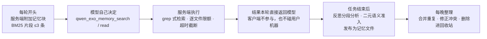

<div align="center">
  
  <h1>QWEN-EXO booster</h1>
  <p><strong>让 Qwen 在长任务里真正记住知识、反思错误，并跑得足够快。</strong></p>
  <p>服务端记忆工具 · 反思记忆 · 工作记忆 · 全程可观测</p>
  <p>
    
    
    
    
    
  </p>
  <p><strong>简体中文</strong> · <a href="README_EN.md">English</a></p>
  
</div>

<br>

QWEN-EXO 是一个 Qwen 混合注意力推理后端。记忆以文件形式留在服务端，由服务端自己执行的工具按需检索，而不是把命中文档反复搬回 prompt；经验不靠人手工总结，而是由服务端在任务成败后自动沉淀、由模型自己补写；每一次搜索、读取、写入和准入都能查到。

> 支持 macOS 和 Linux（Windows 请走 WSL）。支持 Qwen3.5 到 Qwen3.8 以及兼容的二次修改模型，含 MoE。推荐 Qwen3.8-27B。

## 为什么不是 RAG

普通 RAG 的代价是：命中什么就把什么塞回 prompt，知识库越大、命中越多，每轮重复搬运的上下文越脏。QWEN-EXO 不做这件事：原始文件留在服务端知识库，模型像用 grep 一样按需搜索和阅读，只有它自己决定要读的那几段才进入上下文。

| | 普通 RAG | QWEN-EXO |
|---|---|---|
| 知识形式 | 命中文档重新贴回 prompt | 文件留在服务端，模型按需 search / read |
| 检索方式 | 外部 embedding 相似度，命中即注入 | 服务端 BM25 片段提示 + 模型自己换关键词再搜 |
| 准入控制 | 相似就算命中 | 模型自己判断要不要读全文；写回长期记忆要过二元语义审查 |
| 上下文代价 | 每轮重复搬运 top-k 全文 | 每轮最多三条约 200 字的片段提示，其余靠工具自取 |
| 经验积累 | 无，或手工写 prompt | 服务端从真实轨迹自动沉淀，模型自己写工作记忆，每晚自动整理 |
| 可观测性 | 黑盒 | 每次搜索 / 读取 / 写入 / 准入留遥测证据，控制台可回放 |

每个能力都有独立边界，能够单独开关、审查和追踪。

## 一次请求的记忆链路



每轮开头服务端附加一段记忆块，说明这些回忆来自用户知识库和以往会话、与当前会话无关，其中的文件、路径、key、命令和账号不得拿到当前 agent 的工作环境里查找或使用；有 BM25 命中时列出至多三条约 200 字的片段（同一会话内不重复），没有命中时提示可以搜索。模型是否真的去搜、搜什么、读到哪一段，由模型自己决定，服务端只负责执行和记账。

长期记忆的准入使用固定二元读数：`A=通过`、`B=不通过`。每个候选只做一次 prefill，在同一答案位置读取两个 token 的 logprob；`log P(A) > log P(B)` 才通过（等价于二选项 softmax 的通过分数大于 0.5），平分拒绝。没有第三个语义选项，不生成审核文本/JSON，也不回退自回归 Judge。评分失败或结果错位时不写入、不缓存失败，并保留执行失败标记。多个候选独立审核，它省去审核答案的 decode，不省去 prefill；分数不是已校准的真实正确率。反思正文和压缩摘要仍按原生成路径处理。

### 已下线：Q×K 注意力检索与检索侧语义闸门

早期版本把文档编译成原生 K/V + Tensor Bank，用模型自己的 Attention-Q × Bank-K 检索，再逐条交给语义 Judge 审查。这条链路已在 `896957c1b2` 端到端移除：Tensor Bank、Query Probe、PMI 门控、reference Judge、Self-Ask 刷新、因果回放、记忆注入管线及其 job type、CLI 参数、托管设置与启动脚本参数全部删除（单次 −15,698 行）。

移除的理由是线上实测，不是理论判断：在真实 agentic 流量上一个小时零召回（每次刷新都是 `no_eligible_reference`），而每个事件要占用 5–35 秒 GPU——长工具调用上下文让每张规则卡看起来都词面相关，然后全被 Judge 拒掉。保留的部分是会话初始 GDN、反思蒸馏与二元准入（现用于写回长期记忆），以及每轮的 BM25 片段提示和服务端记忆工具。仓库里仍能看到 `document_ingest.py`、`knowledge.py` 等编译期代码，它们不再被任何请求路径调用（`retrieval_mode` 恒为 `file`），属于待清理的遗留件，不要按它们理解当前行为。

## 核心能力

### 服务端知识库：文件就是长期记忆

把技术文档、项目规范、API 资料或团队经验写成 Markdown 上传，它们以原文件形式留在知识库目录，SQLite 只存文件身份、标题、重复样板识别和每文件摘要，不需要编译入库。每轮开头用 BM25 给出至多三条片段提示（词、代码标识符及其 camelCase/snake_case 拆分、中日韩字符 bigram，中文不需分词器），模型自己决定要不要调 `qwen_exo_memory_search` 换词再搜、要不要用 `qwen_exo_memory_read` 读完整上下文——**知识库越大，不等于每轮多注入多少字**。


### 反思记忆：让一次失败变成下一次的起点

服务端在任务结束或客户端压缩上下文时，对已保留的真实轨迹分段分析，逐条核对行动、观察、机制、竞争解释与反证。每条经验附可打开的原始事件引用，并区分**因果已验证、有证据支持、尚未解决**。来源可核对、经验有价值且适用边界明确的条目可获发布资格（`active`），不要求根因已经验证；有证据支持或尚未解决的经验保留观察、假设、条件性建议和缺失证据，不会因此变成已确认根因或必执行规则。

最终准入复用内部二元语义评分路径：在同一答案位置读取 `A=通过`、`B=拒绝` 的 logprob，`log P(A) > log P(B)` 才设为 `active`，平分拒绝。该评分不生成 token，不使用 JSON 结论作为准入替代；此前的结构化分析仅保留证据等级、解释和精确的合并/退休提案。`verified`、固定观察数量、空缺失证据列表和证明布尔字段不再是硬门槛。引用仍须逐字匹配真实来源，目标身份和版本仍须一致；执行失败与语义拒绝分开，失败不缓存为已审查结果。

已成功分析的分段可复用，失败或未覆盖的部分可继续重试。经验按条目保留版本；替换或退休旧条目必须把完整旧条目和变更提案一起交给二元模型审查，通过后才变更。审查策略与模型身份参与结果复用键，旧规则的缓存结论不冒充新二元审核。**分析完成、任务成功和长期记忆准入是三种不同状态。**

已准入的 `active` 反思仍参与会话初始 GDN，按完整条目装入预算，并逐条带上「准入表示经验可用，不代表因果已证实」的提醒；候选和已退休条目不纳入。输入和综合反思保留证据等级、适用范围、缺失证据与条件性表述，不把支持性经验提升为确定因果。已有 active 记忆保留原准入来源，不伪造新二元审查记录。

发布后的反思不再构建向量库或原生状态：它们以带 front matter（`reflection-memory` · `outcome-*` 标签）的普通文本文件写入知识库，模型用同一个 `qwen_exo_memory_search` 就能搜到，相似旧经验改为词面检索，不再由 Q×K 提名。准入资格仍不等于模型真的读过它：只有模型自己搜索并读取的条目才进入上下文。


### 工作记忆与夜间整理：模型自己写、自己改、自己收拾

除了人上传的知识，模型可以用 `qwen_exo_memory_write` 自写每日工作记忆（`work-memory/`），把根因、有效的做法、约束、陷阱和环境事实沉淀成 Markdown 笔记。这个区域是它唯一可写的地方：单文件 16 KiB、总量 256 KiB，写入按滑动窗口限频（每 10 分钟最多 30 次），看起来像密钥、token、密码或私钥的内容在落盘前就被拒绝。发现以前写的笔记错了或过时，模型可以直接 `edit` / `replace` / `delete` 修正它，而不是叠一层互相矛盾的新笔记；删除进回收站，可以恢复。除 `work-memory/` 之外的记忆对模型只读，导入的记忆永远不会被它改写。

每晚本地午夜（也可从控制台或 `POST /qwen-exo/memory/dream/run` 手动触发），被服务的模型自己当 agent 跑一轮整理：先分开列出今日与历史笔记，再搜索、阅读，然后一次一个 JSON 动作地合并重复项、修正冲突、改写、移动、创建或删除笔记与目录，直到它自己声明完成。删除进回收站，密钥类内容同样拒绝写入，每个动作都记在运行日志里（`GET /qwen-exo/memory/dream/runs/{run_id}`）。这是维护任务，走独立 lane，不会挤占前台请求。

### 人格、策略与知识分层

人格不应该和任务历史混成一锅。QWEN-EXO 把人格、PolicyData、Cognition、事实知识和反思记忆分成不同 lane：人格可以稳定地影响行为，执行策略可以持续约束工具使用，任务知识则只在需要时被召回。换任务不会抹掉人格，加载人格也不需要把一整篇说明反复复制进上下文。控制面、知识面和任务面各自可查、可替换、可回滚。

| Lane | 内容 | 投递方式 |
|---|---|---|
| 事实知识 / 反思经验 / 工作记忆 | 文件形式，每轮 BM25 片段提示 | 模型自己调 `qwen_exo_memory_search` / `read` 取回正文 |
| 执行策略 PolicyData | 版本化的团队规范与工具纪律 | 文本指令，整篇注入（不再截断，可热开关与热重载） |
| 人格身份 Cognition | 稳定身份层，与任务历史隔离 | 文本指令，整篇注入 |
| 会话初始 GDN | 启动时构建全局快照（含已准入反思），每会话 COW 固定 | GDN 循环状态 |

人格与 Cognition 不再被 `qwen_exo_max_policy_tokens`（4096）截断——一份 13k token 的人格曾只装得进前三分之一。该限制已移除（持久化配置下次启动自动丢弃遗留键），注入开关可在人格页或设置页热切换（`PUT /qwen-exo/policydata-injection`），磁盘上直接改的文件下一个请求就生效。

### 不靠堆 prompt：尽量不占用上下文

普通 RAG 的代价是把命中文档重新塞进 prompt：top-k 越大、轮数越多，每轮重复搬运就越多。QWEN-EXO 把记忆文件留在服务端，只把「哪里可能有答案」的短片段提示进上下文，正文由模型自己按需取回；能用 GDN 循环状态表达的开场记忆不必复制成自然语言，文本指令只承载需要显式可读的部分。这不是"上下文无限"的宣传，而是把有限上下文留给当前任务、最新工具结果和真正需要模型阅读的证据。

记忆块每轮附加在当轮 prompt 末尾，不返回也不存储给客户端：下一轮只从记忆块之前的状态 checkpoint 重新 prefill（实测约 1450 token 的 prompt 仍有 1024 token 命中缓存）。块体用 `<server_side_qwen_exo_memory_block>` 包裹并转义，明确声明这段由推理服务端附加、不是用户写的也不是模型说的话，提醒其中的内容可能错误、过时或互相冲突，文件、路径、key 和命令不得拿到当前 agent 的工作环境里查找或使用；片段与提示文本计入总 token 预算。已展示过的片段会在会话内记住，后续块带新的进来。同一个方向最多搜两次（第一次 + 换词或换语言再试一次），两次搜不到就认定记忆里没有这方面内容，不再换词反复搜，也不把「记忆里没有」当成回答——这条停止规则每轮写进记忆块，为的是不让模型在搜不到的方向上烧完整轮。

### Attention Bias：有限、可审计（默认关闭）

Score Bias 可以把相关的系统规约、工具轨迹和历史证据提供给注意力路径，但它不是永久放大的"记忆开关"，而且默认关闭（`score_bias=False`、`score_bias_mode="off"`）。它支持 shadow 观察、相关性阈值、最大权重（默认 `score_bias_max=0.05`）、块数上限、年龄窗口与尾部保护：先观察模型会选择什么，再决定是否启用偏置；每次候选、权重、拒绝和实际选择都能通过 telemetry 检查。它与记忆链路相互独立：记忆走服务端工具，Score Bias 只影响当前 prompt 内部的注意力加权。

### Think 截断、工具边界与不完整响应恢复

长思考和多轮工具调用最容易出现截断、半个 tool call 或 reasoning 泄漏。QWEN-EXO 将 reasoning、tool call、tool output 和最终 output 分开处理，并对不完整响应提供受控恢复路径。即使模型在预算边界停止，也不会把半截内部思考直接冒充最终答案。

Responses 的思考预算截断独立于 Observer 和外部记忆工具；它限制目标模型实际生成的思考 tokens，因此保留 EAGLE/MTP 也可执行预算截断。未强制自动且显式关闭 THINK 时不进入两阶段路径；截断后用剩余总输出预算继续回答，耗尽总预算仍标记 `incomplete`。思考与回答在同一个调度请求内完成，自问注入（截断自检问题、Think 中途发散自问）已整体移除。思考期间还有两项可配置的 logit 塑形：思考超过 `qwen_exo_think_suppress_after_tokens`（参考启动模板为 512；独立 CLI 默认 1024）后压低 Wait / Hmm / Alternatively / 等等 等反复验证用词；思考用到预算的 `qwen_exo_think_landing_start_ratio`（默认 0.75）后逐步提高 `</think>` 的概率（软着陆），预算用完时仍由硬截断兜底。`reasoning.budget_forced.observed_tokens` 是实际截断位置；API `reasoning_tokens` 还会计入合成边界／截断控制文本，不应直接等同于该生成限额。

未开启强制自动预算时，托管设置 `default_enable_thinking` 控制未显式指定时是否思考，显式请求设置优先；`default_preserve_thinking` 控制模板是否保留历史 assistant 思考。保留历史不会恢复客户端未发送的 THINK，客户端仍须提供历史推理。

#### 五档思考预算与动态模式

`POST /v1/responses` 可用 `reasoning: {"effort": "xhigh"}` 指定档位。参考启动模板默认关闭强制自动选档，尊重客户端的显式 effort（包括 `none`），默认开启 THINK 并保留客户端提供的历史思考。模板五档最大**生成思考 token** 均为 8192；以下不是独立 CLI／配置类的默认值：

| 预算档位 | 预算 | 非自动选档时的 Flash-Next 模板档位 |
|---|---:|---|
| `min`（兼容 `minimal`） | 8192 | `low` |
| `low` | 8192 | `low` |
| `medium` | 8192 | `medium` |
| `high` | 8192 | `xhigh` |
| `xhigh`（兼容 `max`） | 8192 | `xhigh` |

实际 Qwen3.8-Flash-Next 模板仅支持 `low / medium / xhigh`；模板兼容映射不改变选中档位的预算。关闭强制自动后，`none` 才会关闭思考。五档可在服务端设置 `qwen_exo_reasoning_budget_min/low/medium/high/xhigh`，对应启动环境变量 `QWEN_EXO_REASONING_BUDGET_MIN/LOW/MEDIUM/HIGH/XHIGH`。非强制的固定模式下，未显式指定 effort 及内部任务继续使用 `qwen_exo_max_reasoning_tokens`；该默认预算不钳制显式档位。请求总输出上限和模型上下文限制仍然生效，预算不是必须消耗的 token 数。

自动选档与模板 effort 分离：所有 JEV 自动选择的请求固定使用共享接口 `high`（Flash-Next 渲染为原生默认 `xhigh`），只有硬思考预算随 `min/low/medium/high/xhigh` 改变。这样不会因为预算切换而改写开头的 system 指令，保留相同历史的前缀缓存；不代表历史内容变化、缓存淘汰或重启后也能命中。代价是自动模式不再逐轮切换原生 effort 指令。未经过自动选档的请求保留原有模板映射。服务端私有标记区分自动请求，不接受客户端伪造，也不写入公开 Responses 历史。

为兼容当前安装的 OpenAI SSE 事件模型，响应元数据会把 `min` 写为 `minimal`，`xhigh/max` 写为 `high`，`none` 写为空；该序列化兼容不改变实际预算。服务端自动补齐的默认 effort 不视为客户端显式选择，因此不会阻止动态选档。

Responses 的动态选档与记忆链路完全分开：动态选档只把当前最后一条真实 user 消息原文交给内部 JEV（`/v1/systemone`），不再构造 canonical JSON/序列化包装，也不读取旧任务、assistant 推理或工具结果。主模型仍接收完整有效历史，两者不再强求共享同一长历史前缀。知识库关闭时不为选档构造完整工作流快照。

参考启动模板设置 `qwen_exo_reasoning_session_once=false`，且不启用自动选档。需要自动模式时可显式启用：`qwen_exo_reasoning_session_once=true` 会让新 user 任务只选一次档位，同一任务后续工具轮复用。重发完整历史不会仅因出现旧 user 消息而重新选档；相同文字在后面新增的一次 user 消息仍视为新任务。关闭此设置时自动模式每轮重评，但输入仍只含最后一条 user 消息。新会话、缓存淘汰或服务重启后需要重新选择；无可恢复用户任务时明确失败，不凭工具结果编造任务。

“强制自动思考预算” `qwen_exo_force_auto_reasoning` 在参考启动模板中默认关闭。显式开启后会覆盖客户端 effort，由 JEV 选择预算；自动选档仍只改变硬预算，模板 effort 保持稳定。`reasoning.effort_selected` 记录实际评估 token 数，`reasoning.effort_reused` 记录工具轮复用。选档不在同一流式生成中途重复，且不改变主生成 KV/GDN 缓存策略。

Responses 在单次请求内复用同一份已渲染文本、相同编码选项的 token IDs；prompt 重建后不复用旧结果，缓存不跨请求。默认特殊 token 编码与内部无特殊 token 编码分别保留。纯文本 QWEN-EXO 生成将已编码 IDs 与原文一并交给原生引擎，避免重复编码；Harmony 和多模态仍走原处理路径。该优化减少工具结果回传后的 CPU 前处理，不改变 THINK、上下文上限、工具语义或 KV/GDN 状态。

原生 Flash-Next EAGLE/MTP 在单卡、普通非混批 chunked-prefill 路径下，每个已调度的 prefill 后给已有 decoder 一个最多 8 回合的执行窗口，再继续 prefill。等轮次不等于等执行时间：长 prefill 分块可能比一次 decode 昂贵很多，原先每块只让一次 decode 仍可能让流式输出很慢。窗口按实际选中的非空 decode 回合计数，不把 overlap 中尚未完成的 prefill 等待计入 decode 时间；没有生成请求时持续 prefill，没有新 prefill 时持续 decode。每次 decode 仍执行结束过滤、内存检查及既有回收逻辑；该调度不启用 speculative mixed-chunk，不释放停放请求的 KV/GDN/PLE 状态，不改变采样、思考预算或缓存隔离。代价是冷长请求的首字可能稍晚，不增加 GPU 算力，也不保证固定毫秒级延迟。非推测后台优先级、target-only/MTP 通道切换及取消行为保持独立；PP、disaggregation、DP 同步、HiSparse、hybrid-SWA、DLLM 等未验证路径保持原行为。

此前单回合交替的一次三轮 64K 冷 prefill 与 512-token 生成重叠实验中，最长流式停顿中位数从 5.56 秒降至 1.46 秒，生成总耗时从 14.92 秒降至 10.50 秒；冷请求耗时从 5.93 秒增至 6.36 秒。该历史数据不是当前 8 回合窗口的测量。两侧均使用相同输入哈希、MTP/Graph 配置和输出上限，冷请求缓存为 0，后续热请求均命中 61440 tokens；测试期间生产流量仍可进入，因此这是该批样本的调度权衡，不是全负载性能保证或 GPU 算子加速倍率。

原生单卡 Flash-Next 的 target-only 打分与 MTP 生成在安全 forward 边界轮转：同优先级的另一通道不必等待长生成结束。切换前提交 overlap 结果并同步 forward stream，停放原 batch 与 KV/GDN/PLE/请求槽；准入仍计算停放请求、剩余输出和下一轮 decode 的内存需求，不以回收长生成状态换取打分执行。资源不足时继续原生成；不混合两种执行模式。此路径不适用于多卡、PP/DP/CP、disaggregation、LoRA、HiSparse、hybrid-SWA、DLLM、PD multiplexing 或 decode offload。

`/v1/systemone` 在读取完整请求体后监听客户端断开，取消并等待该请求的评分、子任务和预留资源清理；正在等待准入的任务不会在调用方离开后继续派发。正常完成、断连和 handler 取消的竞态都等待 parent 清理结束，不取消其他请求。

chunked-prefill 准入按实际请求槽位计数：继续执行的 chunk 复用已持有的行，不再挤占另一个空闲行的预算；停放请求仍占用并发额度，普通 prefill、PD prefill 与 DLLM 的候选列表使用相同规则。该修复不扩大 KV、Mamba 或输出 token 预算。

QSA 的 decode／固定宽度 verify metadata 合并 layout 与页表更新；兼容的多步 MTP draft metadata 一次提交，仍为每一步保留独立输出，padding 使用保留槽 0。不兼容的 pool／布局继续逐步刷新。decode indexer 的 CTA 档位按 SM 数与行数选择，再遍历实际压缩上下文；512-block fast-topk 对全部候选必选的短行省略评分，只有不读取省略区域的消费者才能使用未初始化 logits，batch-invariant 模式保留完整评分与初始化。MTP draft decode 已复用 sparse selection 的路径不会重复运行 indexer。

FlashInfer CUTLASS MoE 的调优范围覆盖配置的 prefill buffer × attention-DP 大小，常规调优上限为 8192 行，同时保证不小于本次实际输入；PD decode 保留按当前行数向上取 2 次幂的行为。不改变模型精度、采样或服务容量，代价可能是更长的首次调优。未引入 `autotune_v2` 或升级 FlashInfer；CPU 回归和 kernel 解释器检查不代表真实 CUDA 数值、Graph replay 或端到端加速已经验收。

js4090 的这组改动已通过 143 项真实 GPU 检查（含 QSA 边界、CUDA Graph replay、MTP metadata、host KV 和 CUTLASS）及 126 项 CPU 检查、59 个 subtests。停服隔离、相同合成输入的组件 A/B 中，三步 MTP metadata 刷新在 batch 1／4 约从 `0.125ms` 降到 `0.023ms`，QSA indexer 四组样本约降低 `1.6%–4.6%`；这是组件时间，不是整体推理提速倍数。重启后两轮 14814-token 合成序列请求均正确输出相同的 404 tokens：冷请求首字 `2.82s`、首字后约 `113 token/s`；热请求命中 14400 tokens，首字 `0.386s`、首字后约 `138 token/s`。没有旧服务的同输入端到端对照，不据此声称端到端加速倍率。证据与回滚文件位于 `inference-opt-20261020/`，不随源码发布。

第二轮优化保留当前目标精度与采样算法：eligible eager、非 gathered-buffer、batch > 1 的 MTP draft-extend 在 LM head 前只选择每请求最后接受位置；Graph／gathered／单请求保留全行路径，HC hidden 与 QSA seed 仍按完整布局处理。CUDA、非 greedy、topk=1、非 rejection-sampling 的链式 target-only 采样使用轻量 JIT 内核，将拒绝候选保存在寄存器，省去完整 `[B,W,V]` 辅助清零缓冲；通用树与真正 rejection sampling 不变。这不是开启 exact rejection sampling，也不改变随机数生成与消费。

THINK shaping 复用固定 token 列布局与两个有界 pinned CPU staging 槽；每个 forward 的 GPU bias 仍是独立快照，DMA 完成前不覆盖 host 源，verify 用广播而非重复展开。Responses 在单次不可变请求生命周期内复用公共历史规范化结果；instructions、临时 memory 与 assistant 合并不进入该缓存，存储历史使用独立列表，输入或 parent 身份／状态变化时失效。

第二轮隔离验证通过 239 项 CPU 检查和 140 个 subtests、67 项 GPU 检查和 19 个 subtests；单请求 LM-head 性能保护另通过 8 项 CPU 检查和 71 个 subtests。完整 248320 词表固定随机数的 10 组合成对照输出一致，THINK 双 stream 的 20 个延迟快照检查也一致。SM120、width=4、batch=10 的采样组件在全部接受／首位拒绝／末位拒绝时分别约从 `101/111/112μs` 降至 `92/91/92μs`；合成 BF16 head 的 batch=10 约从 `0.941ms` 降至 `0.871ms`。单请求裁剪样本反而更慢，因此默认保留原路径。这些不是完整模型端到端吞吐验收；第二轮候选尚未部署，证据保留于 `inference-opt-20261021/`。

参考 [SSHdotCodes PRO6000 固定版本](https://github.com/SSHdotCodes/qwen-3.8-flash-next-pro6000/tree/1233bf628f42940ec8e4fb060fa35c1a30eecfc2) 的适配须区分格式与语义：W4A16 常驻 MoE 依赖 Marlin 布局，INT8 dense／HC 会改变目标数值。1–8 是物理 token 行数，width=4 时只覆盖至多两请求，不是八并发。默认模型仍保持原精度与采样；完整方案由下面的独立 PRO6000 preset 显式选择，不能复用原模型状态，也不能把参考仓库吞吐直接当成本分支成绩。


### 可观测性：不是黑盒魔法

一次请求到底发起了哪些记忆工具调用（参数、状态、耗时、完整输出）、哪些片段被当作提示展示、反思条目的准入 margin 与证据引用、是否发生 Think 截断、Score Bias 实际选中了哪几块，都可以通过控制台和 telemetry 查看。性能提升可以测量，错误召回可以定位，反思记忆可以回滚——**未经验证的"模型好像记住了"不会被当成事实**。


> 这张截图是旧版「召回轨迹」的 Q×K 一面，已随检索栈一起下线，保留仅作历史参考；新版该页逐请求列出记忆工具调用及其参数、状态、耗时与输出。

### 对话注意力诊断：方便 Agent 开发与排障

**调试 Agent，不必只盯着最终回答猜测。** 当你调整系统提示词、工具返回长度或历史裁剪策略时，可以导入真实会话，观察所选输入位置的 Full Attention 权重如何分布在各条消息和 token 块上，为上下文设计提供可检查的线索，再用实际任务结果验证改动。

- **导入更直接**：上传导出的对话，或从控制台选择保留的服务器会话／当前浏览器会话，无需手工拼接历史。
- **定位更细**：按消息边界或前 N tokens 选择诊断范围；逐消息权重条、分块热力图和原文视图配合查看，区分长工具输出的总占比与每 token 平均占比。
- **结论有边界**：高权重不等于模型理解了某条规则，低权重也不能证明它忽略了规则。诊断辅助提出排障假设，不代替任务验证器或端到端 A/B。

控制台的“注意力诊断”支持上传 ChatML 文本、`messages` JSON、Responses `input` 或 Completions `prompt`，先预览，再按消息边界裁剪到历史某一轮，显式点击运行。上传上限 2 MiB，裁剪后最多 32768 tokens；每次采样 1–4 个末段输入位置，默认从模型实际 Full Attention 层中均匀选择最多 4 个代表层，覆盖前段到最后层，也可手选 1–4 层。层号从 0 开始，不包含 GDN 层；层数不足 4 时选择全部可用层。结果可逐层切换查看消息／工具内容占比、每 token 平均占比和分页热图，不做跨层平均。切换查询位置保留当前观测层；色阶按当前层计算，跨层比较应以原始百分比为准。更多层会增加采样计算与结果传输量。

预览会用当前模型模板和 tokenizer 显示所选消息范围的实际 token 数及有效上限，超限时先禁用运行。可减少消息范围，或显式选择“使用前 N tokens”；即使第一条消息本身超长，也能诊断其有界前缀。token 裁剪直接保留原编码的前缀，不解码再编码、不补结束标记；页面明确显示排除的后缀数量。裁剪后的结果不是完整对话，末尾可能落在消息内部。

也可在“保留的服务器会话”或“浏览器会话”中选择最近记录，直接导入并解析预览，无需另存上传。服务器来源为保留的原始事件／轨迹，不是生成的反思经验；浏览器来源仅包含当前浏览器保存的有限历史。缺失、清理或截断的内容会标记为不完整，不伪造补齐。导入不会自动运行诊断。

诊断使用隔离的内部 target-only 请求，不执行工具、不写入反思记忆、不注入原生记忆、不训练或修改注意力偏置。原始 ChatML／completion prompt 保留所选前缀；结构化工具内容会投影成带身份的纯文本。若 JSON 消息中含多模态控制标记，会替换为惰性文本占位符并标明警告；实际图片、音频或视频不会被读取或分析，这不是原始多模态请求的精确重放。对话及分析结果不由诊断功能持久化。
原始 ChatML／completion 中若含多模态控制标记，会明确拒绝，以免破坏“保留原始前缀”的约定；请改用 `messages` JSON 做带警告的文本投影。结构化工具参数中的控制标记也会转换为惰性占位符。


热图是 post-RoPE Q 与实际缓存 K 重算的 Full Attention 估计：逐头 softmax 后平均，不覆盖 GDN，不代表理解或因果贡献；FP8 缓存量化可能使它与 fused prefill 内核使用的新鲜 K 概率不同。支持 CUDA 的 Triton／FlashInfer 标准 NHD KV 缓存及 eager prefill；不改变 decode CUDA Graph。其他拓扑、缓存或 prefill graph 模式明确返回不可用，不以检索分数替代。

分块热力图按“已采样查询位置 × 连续 token 块”展示，支持 16／64／256-token 块、总权重／每个已采样 token 的均值；同一层和分块设置下使用覆盖所有查询与块的统一色阶，翻页不重标。点击色块查看原文、实际采样数量、总量、均值和峰值，并切换对应查询的文本视图；未采样与零权重明确区分。来源统计分开列出原始正文、正文外标记文本、空白、其他未确认来源文本、跨界及无有效跨度 token，保留全部原始权重和总和检查，不把正文外文本统称为模板，也不将概率解释成理解程度或因果贡献。

接口：`POST /qwen-exo/attention-diagnostics/preview` 与 `POST /qwen-exo/attention-diagnostics/run`。该功能需要控制面和模型 worker 同时加载支持版本；仅更新静态页面不会使采样后端生效。

### 服务器会话管理

控制台“服务器会话”（`#/server-sessions`）提供按会话 ID 搜索、分页、单条删除、跨页勾选删除和清空全部。列表显示更新时间、事件数、保存载荷大小估计、快照数及忙碌状态；删除需要明确确认，清空全部不受当前搜索或分页限制。正在处理请求或写入反思来源时保守跳过忙碌会话，不中断推理。

删除范围是该会话保留的事件日志、所有来源快照及内存轨迹／待反思来源；删除后不能再从这些记录导入诊断或重新反思。已发布的反思记忆文件、知识库文件、人格与 Cognition、正在服务的 Responses 状态和浏览器聊天记录保留不变。这不是遥测、分析缓存或备份的完整隐私清除；SQLite 空闲页可供后续复用，但文件不一定立即缩小。客户端后续重新发送历史时可以产生新的保存记录。

接口：`GET /qwen-exo/server-sessions?limit=25&offset=0&q=`；`POST /qwen-exo/server-sessions/delete` 接受 `{"conversation_keys":["会话 ID"]}` 或 `{"all":true}`，返回已删除、忙碌跳过和已不存在的列表。仅属于现有控制面，不对公共 `/v1` 网关开放；需要后端加载支持版本。

## 实测

### DeepSWE 记忆召回 · GraphQL SWE：18 轮收敛到满分

> 下表是 2026-08 的运行记录，当时仍使用 Q×K 检索 + 语义闸门；该栈已在 `896957c1b2` 下线，这批轮次没有在新记忆链路上重跑。保留它是为了留下真实的收敛轨迹（含回归轮），不代表当前配置复现同样结果。

| 轮次 | F2P | P2P | partial | reward | 备注 |
|---:|---:|---:|---:|---:|---|
| r1 | 12/17 | 811/811 | 0.993961 | 0 | 首轮 |
| r2 | 3/17 | 810/811 | 0.981884 | 0 | 回归 |
| r3 | 13/17 | 811/811 | 0.995169 | 0 | 恢复 |
| r4 | 14/17 | 811/811 | 0.996377 | 0 | |
| r6 | 13/17 | 811/811 | 0.995169 | 0 | |
| r8 | 10/17 | 811/811 | 0.991546 | 0 | |
| r9 | 13/17 | 811/811 | 0.995169 | 0 | |
| r10 | 14/17 | 810/811 | 0.995169 | 0 | P2P 回归 |
| r11 | 16/17 | 811/811 | 0.998792 | 0 | 最接近满分 |
| r12 | 16/17 | 810/811 | 0.997585 | 0 | P2P 回归 |
| r13 | 15/17 | 811/811 | 0.997585 | 0 | |
| r14 | 15/17 | 810/811 | 0.996377 | 0 | P2P 回归 |
| r15 | 15/17 | 810/811 | 0.996377 | 0 | P2P 回归 |
| r16 | 15/17 | 810/811 | 0.996377 | 0 | P2P 回归 |
| r17 | 16/17 | 811/811 | 0.998792 | 0 | 最后差 DSL `initialCount` |
| **r18** | **17/17** | **811/811** | **1.000000** | **1** | **满分 ✓** |

### DFLASH 推理加速

支持 DFLASH 推测解码，Qwen3.8-27B 实测接近 **4×** token 输出。

加速模型：[z-lab/Qwen3.8-27B-DFlash2](https://huggingface.co/z-lab/Qwen3.8-27B-DFlash2)

### 诚实边界

请求仍然有上下文上限。记忆是词面检索：换词、换语言或换关键词都可能搜不到，一条经验也不会自动出现在每一轮，所以既要给模型搜索的机会，也要接受它搜不到。反思记忆是外部记忆而非参数学习，效果依赖轨迹质量；二元准入只表示「经验可用」，不表示因果已证实，使用前仍要核对当前条件与适用范围。三个记忆工具由 QWEN-EXO 服务端提供，换成别的网关就没有它们。实验功能默认不加载，需要启动时显式设置对应环境变量（或同名命令行参数）才会启用。

## 快速开始

### CUDA

```bash
bash scripts/qwen_exo/build_image.sh
```

容器编排参考 `docker/compose.yaml`（服务名 `sglang`）。`scripts/qwen_exo/launch_js4090.sh` 与其原生入口 `launch_native_js4090.sh` 默认采用下述已验证的单张 RTX PRO 6000 Blackwell 96GB 参考配置，不再是双卡示例。不要从后面的历史／可选实验段落拼接参数；其他硬件需显式配置并重新验收，不能直接称为同等最佳配置。

内部任务按父任务继承调度类别：当前请求需要的评分与诊断留在前台；反思及其子任务使用独立的单槽 lane，摘要与记忆整理等维护任务使用独立的三槽 lane。夜间整理走独立 FIFO 队列，不与每会话反思共用组织锁。后台子任务不能自行升为前台；排队取消、超时和完成都会释放 admission。逻辑 lane 不增加 GPU 物理容量：KV/Mamba/请求槽上限仍然生效，前台可抢占后台，后台不能反向抢占。

CUDA 单阶段、非 speculative 调度在后台 prefill 分块边界交替让出前台 prefill/decode，保留同一后台 chunk owner，不缩短反思输入或输出预算。短前台 prefill 可插入；超过剩余 chunk 容量的长前台输入可能仍需等待当前后台 prefill 完成，并非任意长度请求都能立即切换。可用 `QWEN_EXO_CHUNKED_PREFILL_SIZE=2048` 调整分块；六请求部署可设置 `QWEN_EXO_CUDA_GRAPH_MAX_BS=6`，保持 decode graph 为 `full`、prefill graph 为 `disabled`。超过捕获范围仍走 eager；应以混合前后台实测和实际 decode graph 日志验证，不能从配置值推断延迟收益。

未合并 LoRA 可作为固定模型 profile 运行：在独立模型目录的 `config.json` 中设置 `qwen_exo_runtime_lora`，字段为 `schema: 1`、adapter 的 `name`、相对模型目录的 `path`、以及 `file_hashes`（`adapter_config.json` 与 `adapter_model.bin` 或 `adapter_model.safetensors` 的 SHA-256）。不修改原始权重；使用硬链接组织 checkpoint 时，不得原地修改链接文件。配置内容参与模型指纹，adapter 哈希在启动时校验。`service_launcher` 自动加载单个 adapter，TokenizerManager 在批处理规范化前给所有外部与内部请求绑定该 adapter；禁止请求另一个 adapter，以及动态加载/卸载绕过 profile 身份。更换 adapter 要切换 profile 并重启，原生状态重新构建，不能沿用另一 adapter 的 GDN/KV。已验证单卡 Dense Qwen 的原始底模在线 FP8 + 独立 rank-4 LoRA、FlashInfer、六请求 Decode Graph 捕获；这不是量化精度或模型能力提升证明。

### 可选 Engram 外挂表

`QWEN_EXO_ENGRAM_PATH` 指向预先打包的 Engram artifact；这是 Qwen3.5 路径的额外残差注入，与 Flash-Next 的原生 PLE 不同。冻结的基表和 reader 不原地修改；额外训练的稀疏表及 reader 可独立打包，未写入行读取为零。数字、符号和格式 token 不参与注入，字母 token 使用白名单门控。

Responses 请求可设置 `qwen_exo_engram=false` 关闭全部 Engram，或仅设置 `qwen_exo_engram_knowledge=false` 关闭额外训练表、保留冻结基表。两种关闭状态使用各自的 radix 缓存标签，不能复用另一注入状态的历史。`scripts/qwen_exo/build_knowledge_artifact.py` 检查完整训练覆盖、冻结基表／reader 哈希、寻址和权重有限性后打包；模型、数据、reader 和训练产物仍由操作者提供，代码发布不包含这些私有文件，也不代表 Agent 能力收益。

当前 Flash-Next 在线配置仍不设置 `QWEN_EXO_ENGRAM_PATH`，不会因合并代码自动启用 27B Engram reader。

原生 Flash-Next 知识植入使用独立的稀疏 PLE 增量，不训练或复用 27B reader。`scripts/qwen_exo/prepare_native_ple_data.py` 的 `--inventory`／`--prepare`／`--check` 只使用 CPU：按新模型实际 tokenizer／模板渲染完整会话，再切成最多 32768-token 的因果监督窗口，保留真实前两 token 的 n-gram 历史。非 assistant 标签为 `-100`，零监督记录仅计入来源清单，不生成训练窗口；原始角色和工具历史不删减。旧 heldout 可以通过 `--prior-records` 冻结整个首任务分组；这种精确首提示分组不等于已验证的语义任务独立性。

`qwen_exo_booster.native_ple_knowledge` 绑定模型配置、索引、原生表 manifest 和实际 reader 权重字节，提供零初始化稀疏增量、`off`／`real`／`shuffled` 查表与 artifact 往返。打乱只作用于同一 hash head 内的增量值，不改冻结基表。`scripts/qwen_exo/prepare_native_ple_job.py` 记录准备状态和训练硬门禁；不加载主模型、不发生成、不安装包、不自动训练。缺少精确 Qwen4Exp 可微后端或尚未验证 NVFP4 原生反向时，状态明确为 `blocked_native_training_backend`，不能拿推理成功或稀疏表自身的 CPU 梯度冒充全模型可微。PPL／NLL 只作辅助；验收还需相同 heldout 的任务成功、知识相关决策、工具有效性及知识关闭回归。数据、计划和产物必须放在公开源码目录之外。

准备器支持 `--backend-python /path/to/isolated/python`，仅在指定的已安装环境执行 CPU 元信息探测，不改在线环境。实查中，在线 Transformers 5.12.1 没有 Qwen4Exp 注册，而既有独立环境的 5.17.0 已有原生模型；但后者没有该 checkpoint 的 `modelopt` 混合量化加载注册，通用 HF NVFP4 quantizer 也声明 `is_trainable=False`。因此“有架构源码”和“能对这份混合精度 checkpoint 做冻结主模型的激活反向”是两件事，不能只改量化名称或训练标志绕过门禁。

独立后端现由 `qwen_exo_booster.native_ple_checkpoint` 和 `native_ple_training_backend` 实现，而不是修改 HF 的训练标志：严格读取原始 safetensors，保留每个专家的 NVFP4 E2M1 nibble、FP8 block-16 scale 和 FP32 global scale；冻结线性的 backward 重新按需解码权重计算输入梯度，不把全量专家 BF16 权重保存到反向图。主模型从原生 HF Qwen4Exp 的 meta 构造开始，替换专家库和磁盘 PLE 后才放置普通权重；只允许独立 delta 参数有梯度。原生 key/value 投影、四流 GR、GDN、QSA 和 short-conv 保留，窗口历史／知识模式在非重入 checkpoint 的反向重算中固定。

训练参考采用 **W4A16：原始量化权重＋BF16／FP32 激活**，不是在线 W4A4 激活量化的逐位复现；没有偷偷改路由或声称 serving 数值一致。`scripts/qwen_exo/check_native_ple_backend.py --verify-code --profile PROFILE --output PRIVATE_RECEIPT` 仅用 CPU，检查真实 checkpoint 全部文本张量映射、真实专家权重切片解码／输入梯度，以及实际混合加载器上的小型原生模型 causal loss → PLE 梯度。实测 delta 最大梯度 `0.006175774`，关闭增量与相同冻结参考完全一致，原始权重和 artifact 字节不变、原始梯度为零、optimizer steps 为零。准备计划可通过 `--backend-receipt PRIVATE_RECEIPT` 转为 `code_prepared_gpu_validation_pending`；完整模型 GPU backward、32K 显存容量及知识任务收益仍未验证，命令不会自动训练或修改在线服务。

私有两例实验可用 `scripts/qwen_exo/normalize_knowledge_cases.py` 统一 `session.messages` RL JSON 与 `steps.items` 事件 JSON；工具调用／结果和 Think 由程序保真处理，只输出结构计数和哈希，不展示正文，不执行轨迹命令或 HTML。分页缺失和未结算工具调用明确记录，不补造内容；用户提供的 HTML 可以作为第二例额外目标，但标记为用户授权的 artifact 配对，不伪称原轨迹消息。数据准备的 `--memorization-cases` 将恰好两个 case group 全部作为训练来源，没有虚假 heldout。

`scripts/qwen_exo/train_native_ple_delta.py` 仅在显式 `--start-training` 时执行 GPU 训练：原生模型／基表／reader 冻结，零初始化稀疏 delta，batch 1、一个完整 epoch、lr `1e-4`。训练行来自 source `t` 预测监督 label `t+1`，按最小出现次数 2 选择；分块 frozen-head CE 在 backward 重算，避免保存完整 `32768 × vocab` logits。CUDA 使用原生 SDPA 并禁止二次方 math fallback，实际完整窗口仍须通过资源门禁。保存进度用文件句柄写入同目录临时文件并原子替换，避免 PyTorch 隐藏临时文件名拒绝；进度、失败和未完成 epoch 不包装成成功。训练后 off／real／shuffled 用相同 source-task 标签和 BF16 导出值计 NLL，这是记忆重叠实验，不是泛化或 CTF 成功率证明。先暂停推理释放 GPU，结束后恢复推理由操作者／私有启动器负责，不由训练器强制停服务。

CUDA 训练现使用三个独立快速路径：QSA 的压缩 key／RoPE 只算一次，按 query chunk 批量评分和因果 Top-K；NVFP4 packed 权重直接传入 GPU 用 Triton 解码，256MiB 有界 packed LRU 不缓存整套 BF16 权重，路由排序避免逐专家同步；GDN 与短卷积绑定既有 FLA 的可反向 chunk／Triton 内核。只在独立训练进程绑定，不修改已安装 HF 或在线服务。FLA 必须可从训练解释器导入，缺失时拒绝悄悄回退慢路径；复用包时仅暴露 FLA 包路径，不能把另一环境整套 site-packages 放在训练环境之前。

QSA 仅接收无 padding、无缓存的完整因果窗口；非因果／非连续 mask 明确拒绝。原始 block budget 与不完整尾块保留；完全等分的 Top-K 可选择不同但等分的块，因此不宣称 tie 情况逐位一致。验证覆盖 109 项 CPU 检查、41 项 GPU codec 检查，真实专家的解码／前向／输入梯度最大误差均为 0；FLA GDN 与卷积前后向通过 BF16 容差检查。SM120 上单个热专家投影 GPU 解码约 0.036ms，32K QSA 单层索引约 0.081s；这些是组件数据，不是整轮训练时间。训练进度另记录完整窗口耗时、GPU 峰值与实际 optimizer steps，不能用短检查代替完整窗口验收。

### Qwen3.8-Flash-Next NVFP4：隔离单卡路径

`Qwen4ExpForConditionalGeneration` 使用 GDN + QSA、四分支 Gated Residual 和原生 PLE，不能按旧 Qwen3.5 模型直接换目录。官方 NVIDIA checkpoint 是混合精度：主模型 routed experts 为 NVFP4，PLE 为 FP8，MTP experts 为 FP8 分块权重；运行量化名称是 `modelopt_mixed`。

#### 默认部署：已验证的 js4090 参考配置

这是当前验证基线，不是所有硬件／负载都最快的承诺。需要 SM120 PRO6000、兼容 CUDA 环境、完整 Flash-Next NVFP4＋原生 MTP／PLE 文件和足够的主机内存。Host KV 启动准入按实际 cgroup 上限检查；不能按整机空闲 RAM 推断容器可用容量，也不能通过关闭检查强行启动。

| 项目 | 参考启动模板 |
|---|---|
| 容量 | TP=1，context=262144，mem-fraction=0.95，max-running=10 |
| 调度与状态 | prefill=32768，chunk=1024，Mamba 槽=64 |
| KV／PLE | FP8 `fp8_e4m3`，GPU-first Host KV 上限=1300032，磁盘 PLE=`mmap` |
| 执行 | FlashInfer attention／sampling，decode full Graph batch 1–6，prefill eager |
| 模型数值契约 | 已标记的 **MAIN 模型**派生 SM120、Marlin、EAGLE 3/1/4、exact RS／threshold=1 |
| 生成 | output=32768，默认 THINK／保留历史开启，默认及五档思考预算=8192；不强制自动选档 |
| 思考塑形 | suppress=512／strength=5，landing=0.75／bias=8 |
| 功能 | hybrid-prefix／PolicyData 开启；Observer／Score Bias／Capsule／Reflection／Compaction 关闭 |
| 兼容 | 请求解压开启；图像预处理在 CPU，视觉编码仍在 GPU |

```bash
export QWEN_EXO_PYTHON=/path/to/venv/bin/python
PYTHONPATH=python "$QWEN_EXO_PYTHON" scripts/qwen_exo/build_sm120_profile.py \
  --source /path/to/Qwen3.8-Flash-Next-NVFP4 \
  --output /path/to/Qwen3.8-Flash-Next-NVFP4-sm120fast
export QWEN_EXO_MODEL_PATH=/path/to/Qwen3.8-Flash-Next-NVFP4-sm120fast
export QWEN_EXO_DATA_PATH=/path/to/persistent-flashnext-runtime
bash scripts/qwen_exo/launch_native_js4090.sh
```

**必须选择已标记的主模型，而不只是草稿路径。** SM120 会改变 dense／HC 数值与采样契约，标记和模型指纹不能省略；服务启动器在模型目录选择及托管设置之后一次性应用耦合参数。原始全表 scale FP8 PLE 与已有逐行 FP8 PLE 均受支持，但表内容不等价，不能为“对齐配置”擅自转换或复制训练增量。

**已有部署不会被新的 shell 默认值自动迁移。** `service-config.json` 的已保存设置优先于环境默认值，`model-catalog.json` 的选择也可能覆盖 `QWEN_EXO_MODEL_PATH`。通过托管设置与模型选择接口迁移，保留密钥和资料目录，排空请求后由可靠 supervisor／容器重启策略拉起完整启动链。验收实际 `/get_server_info`、`/qwen-exo/status`、配置的 `revision == applied_revision == healthy_revision`、模型的 active/applied/healthy/running 指纹，以及真实 Responses THINK／工具轮；仅看到进程或健康端口不算配置生效。显式环境参数可覆盖普通模板默认值，但不能拆开模型标记绑定的数值契约。

#### 可选：非 SM120 preset 的 CPU 专家换入路径（不是默认）


```bash
export QWEN_EXO_PYTHON=/path/to/venv/bin/python
export QWEN_EXO_MODEL_PATH=/path/to/Qwen3.8-Flash-Next-NVFP4
export QWEN_EXO_DATA_PATH=/path/to/isolated-flashnext-runtime
export QWEN_EXO_TP_SIZE=1
export QWEN_EXO_QUANTIZATION=modelopt_mixed
export QWEN_EXO_KV_CACHE_DTYPE=auto
export QWEN_EXO_SCORE_BIAS_MODE=off
export QWEN_EXO_NATIVE_PLE_DISK_PATH="$QWEN_EXO_MODEL_PATH"
export QWEN_EXO_NATIVE_PLE_BACKEND=pread
export QWEN_EXO_CPU_EXPERT_PAGING=1
export QWEN_EXO_SPECULATIVE_ALGORITHM=
unset QWEN_EXO_ENGRAM_PATH
bash scripts/qwen_exo/launch_native_js4090.sh
```

PLE 从原始 safetensors 按需读行，不把约 51GB 表常驻 CPU/GPU；`pread` 用于 POSIX，`mmap` 是可选后端，不包含未安装的 io_uring 扩展。CPU expert paging 保留模型原生 Top-10 路由和权重，每层仅保留当前专家集；prefill 按实际路由集合分组执行，不能把整批 token 当成只会选同十个专家。启动器选择 `flashinfer_cutlass`、独立 shared experts，并禁用两个阶段的 CUDA graphs。

选择 `QWEN_EXO_NATIVE_PLE_BACKEND=mmap` 时，reader 按 shard 批量收集行与 scale，保持原始顺序和重复行；映射不等于整表常驻。大批量 CUDA 原生逐行 FP8 查询传输原始 FP8 与 FP32 scale，由融合内核执行 FP32 乘法后转 BF16，直接填入已有输出 buffer；小批次、CPU、非连续输出及其他存储格式保留 CPU 解码。回归覆盖有限值逐位一致、带符号零和 NaN 类别。pinned／CUDA staging 在前次异步复制及解码完成后才复用，磁盘读取和准备不进入 graph capture。

QSA 普通 prefill 的地址与累计长度计划只在当前 forward 内共享，各层仍读取自己的 KV；decode graph 保留固定容量 buffer，但仅提取和缩放当前捕获形状（含 dummy rows）。这些优化不改变原生路由、稀疏选择、接受状态或 prefill/decode 调度策略；组件提速不能直接当作端到端加速倍数。

带缓存前缀的普通 QSA prefill 仅在纯 GPU KV pool 中直接将原生稀疏位置映射到 KV bank，在 attention 内读取、转换并缩放选中行，不再物化完整前缀 K/V。`QwenHostFP8KVPool` 只要 `gpu_size < size`（存在主机后缀），就保留每层一次 `get_kv_tokens` 物化完整前缀的基线，再执行 cast/scale 和 dense chunk attention；即使本批选中位置恰好全部在 GPU，也不启用 direct 路径。不从 token 数推断驻留位置，不每层同步读取设备槽位；未经验证的主机分块去重暂存候选不进入此路径。query 长度上界从现有 CPU metadata 每个 forward 计算一次，避免每层读取 GPU 标量。保留 FP8→query dtype→scale→query dtype 的舍入顺序和当前 chunk 写入；无前缀 prefill、decode 和 MTP verify 路径不变。不同 tile/warp 的累加只保证数值容差，不宣称逐位一致。

这是降低临时显存峰值的取舍，不保证所有 chunk 提速：SM120、单请求、全部选中 KV 在 GPU、128K 前缀和 `24/2` 个 Q/KV heads、head dim 256、Top-K 2051 的隔离单层 A/B 中，256-token 增量约 `1.27→0.72ms`、临时峰值 `259.5→3MiB`；1024-token 增量约 `1.79→2.27ms`、`272→12MiB`；4096-token 增量约 `3.98→8.21ms`、`312→48MiB`。基线使用原 GPU-first pool 的 gather/cast/scale 路径，时间为五次交替测量的中位数；服务负载在测量前后采样为空，但 GPU 并非独占。上述不是整模型 TTFT、常驻显存下降或可直接增加 KV 容量的证明，也不代表已部署；主机驻留行仅验证正确性，未测性能。

以上安全边界是本地候选的适用约束，不代表重新部署。线上两个 prefill 文件已回滚；主机分块暂存没有可追溯的基准结果，不能将上述 GPU 单层数据当作它的性能证据。

Host-capable QSA 的选中 KV 路径将槽位清空、逻辑位置映射及 K/V 两次读取合为一个 Triton kernel；不分配选中槽位 scratch，保留原有 BF16 舍入和独立 scale 操作。CUDA 验证覆盖两种 FP8、GPU/主机混合驻留、图重放、因果行与 padding。SM120 上 `2×256` KV 几何、verify width 4、Top-K 2051 的隔离微基准中，batch 1/2 全 GPU 冷读约快 10%，热读耗时约降 40%；50% 主机读取基本持平。这不是端到端吞吐承诺，混入其他请求的测量不计入结论。

已有 PLE 可绑定到独立模型 profile，不必重新下载 NVIDIA 的整张表。磁盘读取支持原始 checkpoint 的 BF16/FP8，以及 `native-ple.json` 声明的 BF16/F16 或逐行 FP8 + FP32 scale。原始 checkpoint FP8 保留 checkpoint 的全表 scale；外部逐行 FP8 先按行 scale 解码为 BF16，原生 PLE 的后续 scale 固定为 1，不能再次乘 NVIDIA 的全表 scale。仅复用表数据，仍加载新模型的原生 PLE key/value 投影，不复用 27B Engram reader。

```bash
python scripts/qwen_exo/build_native_ple_profile.py \
  --source /path/to/original-nvfp4-checkpoint \
  --ple-root /path/to/existing-ple/table \
  --engram-manifest /path/to/existing-ple/engram.json \
  --recovered-mtp /path/to/recovered-mtp.safetensors \
  --combined-source model-fp8-mtp-ple.safetensors \
  --output /path/to/independent-existing-ple-profile
```

构建器校验官方主分片 SHA、MTP 恢复凭据和全部 PLE 源分片，硬链接未修改的主模型/MTP 文件，重建 index，并将 PLE manifest SHA 显式绑定到新 `config.json` 和模型指纹；启动时拒绝源布局/哈希不符。`--source` 须包含 `download-manifest.json` 和 `recovered-mtp-receipt.json`。选择性恢复 MTP 的凭据记录不可变镜像版本、精确 HTTP 206 字节区间和恢复产物 SHA；未下载的 PLE/MTP 合并文件不能宣称通过完整官方 SHA 校验。启动时将 `QWEN_EXO_MODEL_PATH` 与 `QWEN_EXO_NATIVE_PLE_DISK_PATH` 均指向新 profile，使用独立状态目录。

js4090 已实测既有 128 分片、320001536 × 160 的逐行 FP8 表：22 个跨分片、重复及末行查询在 `pread`/`mmap` 的 CPU/CUDA 输出与独立 safetensors 解码完全一致；原生 PLE lookup、异步预取消费和实际 checkpoint key/value 投影也完全一致。该组件 smoke 的 GPU 峰值分配为 144.88 MiB，不是全模型内存指标或端到端生成验收。对原始 BF16 的前 64 行抽查中，既有逐行 FP8/NVIDIA 全表 scale FP8 的 MSE 分别为 `4.20e-8`/`4.41e-8`，不能外推整表精度或 Agent 能力。

原生 Bank 同时保存 KV/GDN、QSA 压缩索引键/坐标，以及 PLE short-conv/ngram 状态；稀疏选择保留完整压缩组和 64-token 对齐。验证阶段只提交接受的 QSA/PLE 状态，普通 GDN 与 ReplaySSM 使用同一接受边界；会话快照显式声明状态组件并拒绝缺项。新模型使用独立指纹和状态目录，不复用旧编译产物或 27B Engram reader。当前路径限制 TP/EP/PP/MoE-DP=1，KV 需 BF16/FP8，不支持旧 NVFP4 KV、dense Score Bias、unified-memory/disaggregation 或通用权重 offload 混用。HiCache、LMCache 与 FlexKV 的 QSA/PLE 主机传输尚未适配，因此明确拒绝启用，不会静默丢失上下文；普通 radix cache 和原生 Bank 不受此限制。

Flash-Next 的知识与反思记忆不再走原生状态编译：文档与反思以文件形式存在知识库中，由服务端记忆工具检索，模型自己决定读哪一段；只有会话初始 GDN 仍使用原生循环状态（含已准入的 `active` 反思）。PolicyData、Cognition、会话压缩及反思来源管理继续使用现有控制面和各自开关，原生 PLE 训练不是启用这些功能的前提。

启用原生 MTP（EAGLE）时，EXO 的 target-only 内部请求使用独立调度，不运行草稿 prefill/verify；外部请求仍保留原生推测解码。Bank 发布和恢复会拒绝缺失、非有限或形状不匹配的 KV/GDN/QSA/PLE 状态，以及重复、乱序或被拆开的压缩组。CPU 回归覆盖完整页导出到稀疏前缀恢复、ReplaySSM、首次热导入和调度切换；这些回归不替代真实 GPU 上的端到端生成验收。

启用反思可设置 `QWEN_EXO_REFLECTION_MEMORY_MODE=active`，会话压缩设置 `QWEN_EXO_RESPONSE_COMPACTION_MODE=active`。Score Bias 保持默认关闭：QSA 尚不支持 dense Score Bias，该限制不等于关闭知识库或反思。已有托管配置可能覆盖启动环境变量，必须核对实际配置；代码更新不会自动改动运行中的服务。

QSA 注意力诊断按真实 top-k 逻辑位置重建概率，未选 token 的概率质量为零，不再用 dense softmax 冒充稀疏注意力。无缓存 prefill 读取本次原始 K；带前缀 prefill 读取缓存 K 并应用实际 scale。它仍是概率重建，不是因果解释；CUDA 端到端诊断及完整 checkpoint 的记忆生成/召回需要在空闲 GPU 上另行验收。

这不是吞吐提升承诺：冷专家换入和高多样性 prefill 会增加 PCIe 传输与布局转换。CPU bank 会校验真实 cgroup 内存限额，不能与占用大量主存的生产模型强行同载。组件回归、按行读表和小型内核验证不等于全量 checkpoint 已生成成功；切换前仍须完成全部权重校验及独立端到端生成验收。

CPU 专家库准入按 `memory.stat` 扣除可回收的干净文件缓存，而非将 `memory.current` 全部视为必须常驻；共享、脏页、写回和锁页不计作可用容量，未触页的专家预留仍累计，并保留 8GiB 余量。PLE 仍使用硬盘 `pread`，不整表加载或锁页。BF16 GEMM 默认分支也须检查实际 GPU：SM120 不启用仅供 SM100/103 的 split-K 内核，不能因分支内导入造成初始化异常。

主模型可容纳于显存时，设置 `QWEN_EXO_CPU_EXPERT_PAGING=0`，并用 `QWEN_EXO_MOE_RUNNER_BACKEND=flashinfer_cutlass` 显式选择 SM120 专家执行后端；`QWEN_EXO_NATIVE_PLE_DISK_PATH` 与 `pread` 保持不变。这仅把主模型专家留在 GPU，不会把 PLE 整表搬入 RAM/GPU。js4090 此组合已完成完整权重加载与启动预热；CPU Top-10 换入路径则曾因长文档编译超过 120 秒而无法完成启动，不能把单层数值一致性当成可用吞吐证明。PLE offload 加载后的清理使用统一 `current_platform.empty_cache()`，其导入必须在完整加载路径可用。

主模型常驻 GPU 时，磁盘 PLE 支持 `QWEN_EXO_CUDA_GRAPH_BACKEND_DECODE=full`，prefill 仍需 `disabled`。每个捕获 shape 分配固定 BF16 PLE 行缓冲；replay 前在图外根据当前 token／请求槽历史按需读行、解码并填充，补齐行清零。Graph 内只读这些缓冲，并由原生 forward 提交 ngram／短卷积或 MTP 候选状态；图外准备不能提前提交。真实 CUDA 回归覆盖 token 变化、请求重排、padding 和 TARGET_VERIFY，检查数值与状态边界；不能删除 NVMe reader 的捕获期 I/O 拒绝来冒充支持。

原生 MTP 使用同一 profile 的 `EAGLE` 路径，可设置 `QWEN_EXO_SPECULATIVE_NUM_STEPS=3`、`QWEN_EXO_SPECULATIVE_EAGLE_TOPK=1`、`QWEN_EXO_SPECULATIVE_NUM_DRAFT_TOKENS=4`。草稿路径指向同一 profile，草稿量化为 `QWEN_EXO_SPECULATIVE_DRAFT_MODEL_QUANTIZATION=modelopt_mixed`，其 block-FP8 专家后端为 `QWEN_EXO_SPECULATIVE_MOE_RUNNER_BACKEND=triton`；主模型仍用 FlashInfer CUTLASS。Qwen4 GR 的推测隐藏缓冲宽度必须取 `hidden_size × hc_count`（当前为 10240），不能错误地按 2560 分配。必须以真实接受长度和请求延迟验证加速，配置存在不是性能证据。

压缩 QSA 的 `draft_extend_cuda_graph=false` 是动态接受长度的能力边界，MTP 草稿 extend 保持 eager；目标 TARGET_VERIFY 和草稿 decode 捕获 full Graph。QSA 不导入未使用的 DeepSeek DSV4/FlashMLA 依赖。MTP LM head 的 `enable_dp_lm_head` 来自运行 `ServerArgs`，不是 `ParallelContext` 字段。

js4090 的真实组合验收：固定空闲单请求、相同原生 prompt、温度 0、强制 128 token，原 eager 总耗时 `10.412s`（TTFT `0.237s`，decode `12.48 token/s`）；full Graph + 原生 MTP 两次为 `1.397s`/`1.209s`（decode `105.52`/`121.86 token/s`）。MTP 草稿接受率 `0.644`/`0.699`，每次验证输出长度 `2.909`/`3.122`；真实日志有 `cuda graph: True`。这是固定短请求的组合收益，不是 Graph/MTP 独立归因，也不是所有任务或 200K 长窗吞吐承诺；混合精度下前后及重复生成非逐 token 一致，不宣称 bit-exact。

此前网关 SSE 中文问答在 `0.82s` 返回正确结果并以 `response.completed` 结束；三个并发请求的算术、排序、12648-token 上下文记号检查均通过。当时运行配置为 `context_length=200000`，实分配 KV 容量 `250560`，`mem_fraction_static=0.93`、Mamba 槽 `64`，decode Graph 捕获 batch 1–5，超过捕获范围走 eager。会话摘要胶囊也已关闭，避免每轮回答后再生成 256-token 隐藏摘要；知识、PolicyData、反思和压缩继续关闭。

带图请求显存紧张时，可设置 `QWEN_EXO_MM_PROCESS_CONFIG='{"image":{"device":"cpu"}}'`：启动器传入原生 `--mm-process-config`，显式图片／视频设备不再被自动 CUDA 选择覆盖。CPU 图片配置同时关闭 nvJPEG GPU 解码；保留同一处理器、原始图片顺序和分辨率策略，不去重、删图或降低清晰度。视觉编码仍在 GPU，需独立留出工作区；js4090 已将托管和启动显存比例从 `0.93` 调为 `0.90`，保留 4K THINK、历史 THINK 和 EAGLE/MTP。完整 1080p PNG／JPEG、四张重复图及两张不同图的真实 SSE 均完成正确颜色回答，验收窗口无新增 CUDA OOM；CPU 单图、重复图和不同尺寸图的像素／网格／token 与参考完全一致。该门禁不代表任意图片数量、尺寸或并发均已验收。

Qwen4 长历史 FP8 K/V 可通过 `QWEN_EXO_HOST_KV_CACHE=1` 使用显存优先、pinned 主存溢出的混合布局。启动时从现有显存预算扣除完整逻辑跨度的 QSA 索引，再按页分配主模型＋MTP 共用的 GPU 槽位前缀；只为剩余槽位分配主存，不保留完整双份镜像。新分配和已释放的槽位优先复用显存；已有主存行不做后台 LRU 迁回。GPU 同时保留 QSA 索引、GDN／PLE 状态和选中工作集，CUDA kernel 根据逻辑槽位直接访问对应银行。预算足够时整个原始 KV 银行均可驻留显存。前缀预填充、目标验证和草稿 decode 保留原有语义及 Graph 路径；接受行搬运必须保留快照式并行赋值，避免跨层级或重叠搬运破坏历史。该路径限制 CUDA TP/EP/PP/DP=1、FP8 E4M3、NHD、原生 topk=1 MTP 和 FlashInfer TRTLLM 稀疏注意力；不与通用 HiCache、unified-memory、disaggregation 或 FP4 混用。

Host KV 同时要求 `DCP=1`，未实现的解码上下文并行直接拒绝。原生 Bank 导出在 inverse RoPE 前恢复全局 FP8 K/V scale，还原时把 BF16 激活放到逻辑槽位所在 CUDA 设备后经池 API 写入；缩放各应用一次，不把 pinned CPU 缓冲误当执行设备。Bank 快照协议已升为 `qwen-exo-native-state-bank-v2`，旧版本需重建，不复用旧缩放语义的产物。该源码修复不代表在线服务已部署此版本。

六路 200K profile 保持 `QWEN_EXO_MAX_RUNNING_REQUESTS=6`、`QWEN_EXO_MAX_TOTAL_TOKENS=1300032`、`QWEN_EXO_CUDA_GRAPH_MAX_BS=6`、上下文 `200000`、原生 MTP 和磁盘 PLE。此前 `0.93` 启动预算得到 255616 个 GPU 有效槽位及 1044416 个主存溢出槽位，主模型＋MTP 原始 K/V 分别约 3.17GiB 显存、12.95GiB pinned 主存；dummy page 计入 GPU 字节，QSA 索引、GDN 和工作区另计。此槽位记录不作为当前 `0.90` 配置的容量验收。布局仍是启动预算下的固定分段，不是每次请求按 `nvidia-smi` 空闲量搬运整个会话。

混合方案完成 88 项回归及 11 项 subtests；两轮六路长请求各输入 199744 tokens、生成 128 tokens，并返回各自正确记号。在线混合负载采样到 6 路运行，驻留峰值分别为 845120／904640，未重现此前 1199232 的满驻留峰值，因此不能沿用旧结果宣称混合模式已通过该峰值验收。后续测试按用户要求停止，模型服务继续运行。证据位于 `bench/mixed-kv-20261005/{acceptance,replay-acceptance}.json`。

以下为此前全主存模式的验收记录，不是当前混合布局的峰值证明：

六路实际验收已通过：六个独立 namespace 各输入 199744 tokens，均生成 128 tokens 并返回各自正确记号；采样峰值为 6 路运行、1199232 个驻留 KV tokens，日志对应 `cuda graph: True`。第二轮重复流式请求也通过相同容量与隔离检查。第一次串行灌入每路耗时 28.67–35.72s；之后六路请求总耗时约 174s（五路前缀未命中、重做 prefill），重复流式轮约 92.15–92.55s（部分前缀命中）。这些端到端时间包含冷 prefill、排队和其他长请求对 decode 的影响，不能当作稳态 decode 速度；不保证六个长会话都快速命中。普通网关短问答在该模式下已返回 `response.completed`。实际 Response ID 的两个并行分支及后续查询分别保持 LEFT731／RIGHT842，未串线。证据位于 `bench/six-way-host-kv-20261005/{acceptance,stream-recovery-acceptance,session-branch-acceptance}.json`。

Responses 会话关联优先已验证的 `previous_response_id`／压缩 lineage，其次 `prompt_cache_key`，再用 system／instructions 和首条 user 首行的版本化 SHA256 标签兜底。完整 canonical head SHA256 仍作为区分符，并将模型指纹加入 radix namespace；首行相同或 CRC 相同不能直接共享可写状态。实际 KV 复用仍匹配完整 token 前缀，平行分支各自持有 GDN／PLE 工作槽。标准 Anthropic Messages 没有统一的会话 ID，不从 `metadata.user_id` 猜造，也不改变 SGLang 原有 `session_id` 传输契约。

该 GPU 常驻组合随后通过真实网关 `/v1/responses` 流式生成：中文算术请求正常返回并以 `response.completed` 结束；本机控制台也完成实际聊天。当前试用配置按用户决定关闭外部知识、PolicyData、反思记忆及依赖外部记忆的 Responses 压缩，原始文件保留。关闭 adaptive refresh 时必须同时将 CLI-only 的 `QWEN_EXO_CONTEXT_INTEGRITY_MODE=off`，否则启动校验失败，托管配置可能自动回退；以在线 `applied_revision == healthy_revision == revision` 和实际功能开关确认生效。


#### PRO6000 完整优化 preset：GPU 与启动验证通过，未达 200 token/s

`config.json` 的 `qwen_exo_sm120_fast` 标记将该方案绑定为独立模型，而非进程级 monkeypatch：

| 组件 | 新路径与回退边界 |
|---|---|
| Persistent W4A16 MoE | 复用 NVIDIA ModelOpt→Marlin 的 NVFP4 权重与尺度，1–8 物理行走常驻 tensor-core 队列；大行数保留同 W4A16 精度的普通 Marlin，不保留第二份 CUTLASS 专家权重。 |
| INT8 dense | 原始 BF16 heavy dense 层转 G128 INT8＋BF16 scale；小行数 MMA，prefill／大行数按同一 BF16 反量化权重分块 GEMM。非 BF16 的原生 FP8／NVFP4 层不被误读。 |
| HC 融合 | Down G128、Up G64 的 INT8 HC；层内 attention combine 融入下一次 MLP mix。大行数使用同一反量化权重；跨层仍物化 Tensor，保留 PLE、latent、activation editor 等边界。 |
| FP8 MTP | 保留原生 block-FP8 草稿主体，完整共享目标 INT8 head 模块及尺度；图输出的 proposal 在后续 target forward 前取得独立副本。 |
| 截断 proposal＋exact RS | 草稿按自身温度／top-k／top-p 产生并保留真实完整词表 q；target 按 p/q 与 residual 验证。无静态 hot map，词表仍为 248320。 |
| GDN／Top-K／Sampling | 小行数 gated RMSNorm＋输出投影融合、sorted Top-K≤64；设备端证明 cutoff ties 完整时使用稀疏 verify，否则完整词表回退，不用固定“多留 8 个”冒充严格覆盖。 |

每个串行目标 CUDA Graph 为所有 routed 层复用一份私有 MoE arena，不为每层重复分配；不同 graph／stream 不共享控制计数器。preset 要求 SM120 PRO6000 resident-grid 几何、BF16 激活、TP/EP/PP/DP=1、untied head、无 LoRA／CPU expert paging。原有 host KV、磁盘 PLE、上下文与并发上限不因 preset 被压到两路。精确 RS 保持的是**该 INT8/W4A16 目标的分布**，不恢复量化前目标。

Marlin 加载按专家在原 packed 存储内重排权重／FP8 scale，不累积整层输出后再 `stack`；不分配仅 FlashInfer 消费的 swizzled scale 副本。PLE 加载结束即释放参数索引，避免闭包循环将已被 INT8 替换的 BF16 参数保留到 GC。HC 的大行数 BF16 回退仍保留，不将其误当作无用副本删除。显式 JSON Graph 配置先归一化，再执行磁盘 PLE／CPU expert paging 的 Graph 兼容性检查。

只创建模型视图，不启动服务：

```bash
PYTHONPATH=python python scripts/qwen_exo/build_sm120_profile.py \
  --source /path/to/native-flash-next-profile \
  --output /path/to/separate-pro6000-fast-profile
```

权重硬链接但不改字节；config 和可编辑 metadata 独立复制。新 config 参与模型指纹，必须重建该模型的 KV/GDN 状态。选择该模型后，`service_launcher` 在托管设置之后派生 `--qwen-exo-sm120-fast`、Marlin、原生 EAGLE 3/1/4 与 exact-RS／threshold=1 的耦合参数；不能只给原模型附加一个 fast flag 来绕过指纹隔离。

验证已从离线编译推进到真实 PRO6000：sampling 7 项、INT8 dense 3 项、GDN 94 项、HC 7 项、MoE 8 项及 QSA state 5 项 GPU 检查通过；MoE 重排与原实现逐位一致，覆盖不同 Graph／stream 的私有 scratch。147 组小行数 INT8 MMA／replay 与 FP32 累加 oracle 在原容差内一致；9 组大行数回退保持原 BF16 cuBLAS 行为，不把其 reduction rounding 差异冒充 MMA 错误。Graph 参数校验及 PLE／scale 的最新 CPU 回归另通过 32 项、81 个 subtests，3 项 CUDA-only 跳过。

独立模型实际完成加载、完整 decode Graph 初始化、算术／1–128 序列检查及双请求并发检查。保持 context=262144、max-running=10、host-KV token 上限=1300032、mem-fraction-static=0.95、chunk=1024、EAGLE 3/1/4 和 exact RS；12 个 THINK 长输出样本均生成 4096 tokens，temperature=1、top-p=0.95、top-k=20，未忽略 EOS。客户端首批输出后的 decode 中位数 **95.98 token/s**，范围 **48.07–103.08**；TTFT 中位数 0.204s，accept length 约 2.09–2.52，整个验收进程峰值显存 92249 MiB。**未达到 200 token/s，也未完成广泛质量回归或同输入旧版本 A/B，不能声明整体提速。** 证据位于 js4090 的 `/root/autodl-tmp/pro6000-port-20261021/runtime-acceptance/`；模型视图仍与原模型指纹、KV/GDN 状态隔离。

实验启动入口随后切到同一优化源码／独立模型，Supervisor `qwen` 在 30000 启动并达到 ready，未恢复旧模型；10 个同时发起的原生算术请求全部正确。带临时密钥的 `/v1/models` 与 Responses SSE 已贯通，后者以 `response.completed` 结束，delta 与终态文本一致、末个数值为正确结果，但未遵守“只输出数字”的严格格式，因此该格式 smoke 仍记录失败，不能称全部质量门禁通过；临时密钥已撤销。

实验 launcher 必须继承原入口的 `SGLANG_ENABLE_REQUEST_DECOMPRESSION=1`；遗漏后，PI／网关发送的压缩 JSON 会被错误地直接解析，返回 HTTP 400 `There was an error parsing the body`。已恢复该开关，并使用本机 PI 的既有 `qwen-local` 公网配置验证成功，未修改客户端密钥或要求关闭压缩。

同轮还纠正了实验入口绕过 `service_launcher` 的功能回归：最终重新使用完整 `launch_native_js4090.sh → launch_js4090.sh → service_launcher`，继承原始托管设置、人格／知识目录与 API key store，独立模型只隔离 KV/GDN 状态。运行时 `reasoning_parser=qwen3`、`tool_call_parser=qwen3_coder`；本机 PI 经原公网配置以 xhigh 完成两轮 THINK、一次真实 read 工具调用，正文无 THINK／tool-call 控制标签。未用关闭 QWEN-EXO 功能换速度。

随后选择性加入不重新量化的执行优化：INT8 dense 使用精确整数转换和 BF16 成对乘法，仍在 MMA 前按 BF16 舍入；GDN 的 QKVZ／BA 已量化权重与尺度一次合并为共享存储，小行数合并 GEMM 并启用已有 ratio-3 splitter；HC 必须物化的 combine 边界改成单 kernel，保持 FP32 分步乘加再转 BF16；PLE 的 ≤128 行 mmap gather 改为直接按行拷贝，prefill 继续向量化。保留现有 NVFP4/W4A16 persistent MoE、FP8 MTP、完整目标词表与 exact RS；未照搬静态 draft 热词表、shared-expert 融合的不同舍入算法或跨 PLE／EXO 边界融合。

最新验证：128 项 GPU 检查和 11 个 subtests 通过；CPU dense/worker 检查 19 项和 73 个 subtests 通过；PLE 检查 17 项和 100 个 subtests 通过，3 项 CUDA-only 跳过。dense 新旧内核在 12 组形状及 3328 组 signed-byte／scale 边界组合中数值一致；完整 LM head 交错计时基本持平，其余部分形状降低耗时。真实模型最终十请求并发算术全部正确。

保留完整 EXO 功能的同模型 A/B（相同 prompt、THINK、temperature=1、top-p=0.95、top-k=20、每次 2048 tokens，预热后各三次）：baseline decode 中位数 107.02 token/s，候选 105.34 token/s；按 accept length 归一化的步骤率估算分别为 44.33／45.49 steps/s。**组件优化未证明稳定的端到端吞吐提升，200 token/s 仍未达到**。相同 32 道固定抽样 GSM8K、temperature=0、关闭 THINK、双并发检查：baseline 30/32，最终候选 31/32；这只是不退化的有限样本证据，不是全量质量保证，也不是对原始 BF16／W4A4 模型的比较。证据：`/root/autodl-tmp/nvfp4-speed-20261021/`。

PLE 内存／I/O 实测：容器 cgroup 上限 120 GiB、soft limit 118 GiB；当前 FP8＋row-scale 表约 48.88 GiB，展开 BF16 为 95.37 GiB，不能以宿主机空闲内存推断可安全整表 pinned。两次 2048-token decode 分别读取约 803／376 MiB、发生 2356／1324 次 major fault，但 cgroup I/O pressure 只有约 54／23 ms，内存 pressure 约 145／55 ms；磁盘确有参与，但这些样本不支持“磁盘等待是速度减半的主因”。CPU warm 32／128 行 gather 从约 263／783 μs 降至候选算法约 31／116 μs，排除了 GPU 索引同步与 H2D，不代表完整 PLE 延迟。未启用整表 BF16 pinned，也未更改 PLE 权重。

#### 四项执行优化候选：已实现与验证，未通过吞吐上线门禁

在保留同一权重、INT8 舍入、完整目标词表与 exact RS 的条件下实现了四项扩展：PLE 图输入准备拆成 start/finish，让 CPU 查表与 replay metadata 准备重叠，并复用有界 pinned 索引缓冲；草稿 q 直接写入最终 `[B, steps, V]` 切片，保留 replay 后独立快照与所有 padding 步清零；将 INT8 shared expert 加入原 NVFP4 persistent MoE 队列；在非 PLE、非 EXO 干预和非中间隐藏状态观察的边界，连接本层 MLP combine 与下一层 attention mix。跨层 HC 使用独立严格算术 specialization，原层内融合不被改写；MTP 最终隐藏状态仍完整物化。

最终候选联合回归 **120 项和 373 个 subtests 全部通过**，覆盖 CUDA 数值、q/RNG、padding→full→padding、跨 Graph／stream、反序 pending gather、状态提交与原生大行数回退。候选实际 PI xhigh 完成 THINK 与 read 工具调用，正文无控制标签；十路原生算术均正确。实际 trace 出现 shared persistent kernel 与严格跨层 HC kernel，非仅接线。

合成 hot-cache shared-expert 组件测试在 M=4 时，unique routing 约 92.88→84.05 μs、重复 routing 约 26.12→19.19 μs，不能当作整模型加速。完整 EXO 配置不变、官方模板原生生成、temperature=1/top-p=.95/top-k=20、2048 tokens、一次预热后三次的 A/B：原版中位数 **112.86 token/s**；I/O 工作线程执行 CUDA event 同步的首版仅 **58.17**；同步回 producer thread 后一版 **106.47**；去掉额外 event 往返的 pinned-copy 候选 **93.85**。恢复原版后重测为 **93.76**，说明存在明显时序／采样波动，不能把前后全部差异归因给代码。所有候选均未证明稳定整体收益，故**运行入口恢复原完整 EXO 版本，不默认部署这四项扩展**。固定同样 32 道 GSM8K，原版 30/32、最终候选 31/32，仅是有限质量证据；未声明模型能力提升或 200 token/s。实现保留在 `/root/autodl-tmp/nvfp4-four-20261021/`，测试和回退证据在其 `evidence/` 下；最终运行源码仍为 `/root/autodl-tmp/nvfp4-speed-20261021/candidate`。

### Apple Silicon

macOS 不需要 Docker，也不需要 CUDA，走原生 MLX：

```bash
bash scripts/qwen_exo/install_mlx.sh
export QWEN_EXO_MODEL_PATH=/path/to/Qwen3.8-27B
export QWEN_EXO_DATA_PATH=/path/to/qwen-exo-runtime
bash scripts/qwen_exo/launch_mlx.sh
```

## 控制台

控制台默认只监听 `127.0.0.1`，不要直接暴露到公网。本地建隧道：

```bash
ssh -N -L 30000:127.0.0.1:30000 <gpu-user>@<gpu-host>
```

然后打开 `http://127.0.0.1:30000/qwen-exo/`。

| 入口 | 用途 |
|---|---|
| `/qwen-exo/`（`#/overview`） | 总览与运行状态 |
| `#/chat` | 对话 |
| `#/trace` | 召回轨迹：逐请求的记忆工具调用 |
| `#/attention-diagnostic` | 对话注意力诊断 |
| `#/server-sessions` | 服务器会话管理与删除 |
| `#/knowledge` | 知识库、人格（PolicyData/Cognition） |
| `#/reflection` | 反思记忆与夜间整理运行记录 |
| `#/editor` | 轨迹微调（实验，需启用） |
| `#/catalog` · `#/api-keys` · `#/settings` | 模型目录 · API 密钥 · 托管设置 |

## API

OpenAI 兼容。

```bash
curl --no-buffer http://127.0.0.1:30000/v1/responses \
  -H 'Content-Type: application/json' \
  -d '{
    "model": "duckgpt",
    "input": "解释当前服务的混合注意力状态如何恢复。",
    "stream": true,
    "max_output_tokens": 256
  }'
```

```bash
curl 'http://127.0.0.1:30000/qwen-exo/knowledge/tree'                 # 刷新索引，返回目录与统计，不含全量文件行
curl 'http://127.0.0.1:30000/qwen-exo/knowledge/files?area=imported&limit=100&offset=100' # 第二页文件元数据
curl 'http://127.0.0.1:30000/qwen-exo/knowledge/search?q=deploy'      # 与模型同一套词面检索
curl 'http://127.0.0.1:30000/qwen-exo/memory-tool-calls?limit=10'     # 最近的记忆工具调用
curl 'http://127.0.0.1:30000/qwen-exo/request-traces?limit=10'         # 请求索引
curl 'http://127.0.0.1:30000/qwen-exo/telemetry?limit=100'             # 遥测
curl 'http://127.0.0.1:30000/qwen-exo/memory/dream'                    # 夜间整理状态
```

知识库文件列表使用服务端分页，控制台每页 100 行。`/knowledge/files` 支持 `folder`（空串为根目录）、`nested`、`q`、`area=all|imported|work`、`limit=1..200` 和非负 `offset`，返回 `files/total/total_bytes/offset/limit`。翻页只读取 SQLite 元数据，不重新扫描文件系统或返回正文；总数与文件行来自同一读事务。目录和 `work-memory/` 归属按大小写及路径边界精确匹配；名称、标题和总结标题筛选采用 Unicode 大小写折叠的字面子串，`%`、`_` 不作为通配符，查询最多 256 字符。目录统计包括空目录及已索引隐藏目录。后台总结／整理继续使用完整 `metadata()`，不受页面上限影响。

页面在筛选、目录或区域切换时回到第一页，忽略已过期请求；加载失败后仍可修改筛选或重试。重命名／移动后刷新当前目录，删除末页最后一项时自动回到有效页。该 API 形状与前端资源需要配套更新；代码提交不代表线上部署或重启。

## 本地验证

不加载线上模型：

```bash
PYTHONPATH=python python -m pytest test/registered/qwen_exo -q
```

构建控制台：

```bash
cd frontend/qwen-exo && npm ci && npm run build
```

GPU 预检：

```bash
python3 scripts/qwen_exo/check_cuda.py
python3 scripts/qwen_exo/check_imports.py
python3 scripts/qwen_exo/check_kernels.py
python3 scripts/qwen_exo/smoke_contracts.py
```

## 目录

```text
python/qwen_exo_booster/             运行时、记忆工具与索引、反思、Observer、API
python/sglang/                       推理引擎与 scheduler 集成
scripts/qwen_exo/                    构建、启动、预检、smoke 与评测工具
scripts/qwen_exo/corpus/knowledge/   事实知识与反思知识源
scripts/qwen_exo/corpus/policydata/  版本化 PolicyData 源文件
scripts/qwen_exo/corpus/cognition/   可选 Cognition 源文件
docker/                              Dockerfile 与部署配置
frontend/qwen-exo/                   React / Vite 中文控制台
test/registered/qwen_exo/            回归测试
```

## 许可

Apache-2.0。基于 SGLang 二次开发。
