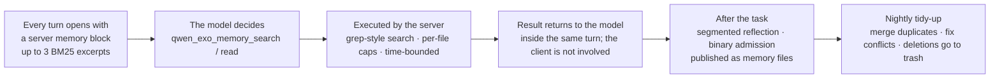
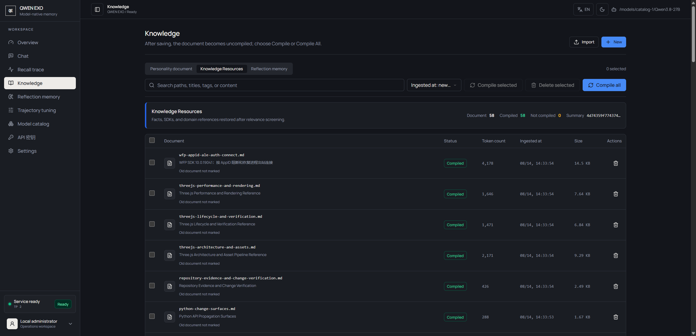
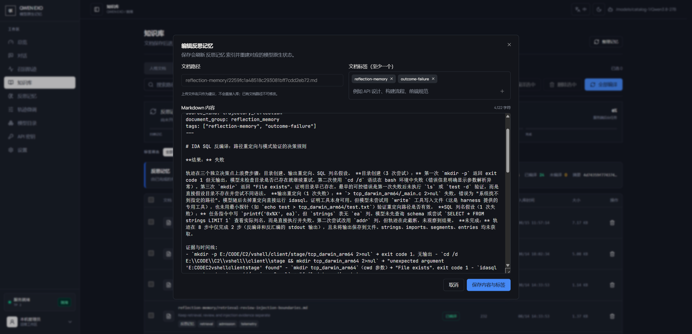
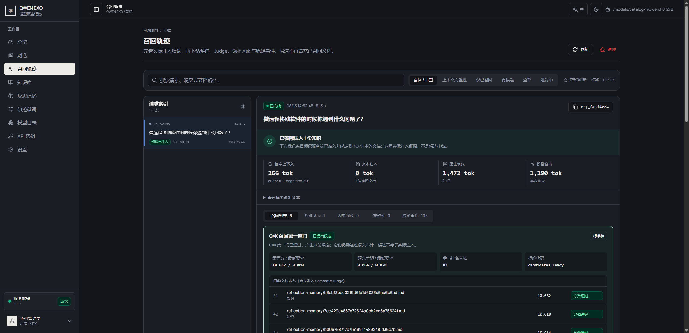

<div align="center">
  
  <h1>QWEN-EXO booster</h1>
  <p><strong>Make Qwen actually remember knowledge, reflect on mistakes, and run fast on long tasks.</strong></p>
  <p>Server-side memory tools · Reflection Memory · Work memory · Full observability</p>
  <p>
    
    
    
    
    
  </p>
  <p><a href="README.md">简体中文</a> · <strong>English</strong></p>
  
</div>

<br>

QWEN-EXO is a hybrid-attention inference backend for Qwen. Memory stays as files on the server and is fetched on demand by server-executed tools instead of shipping matched documents back into the prompt. Lessons are distilled by the server after each success or failure and written back by the model itself. Every search, read, write, and admission decision is traceable.

> Runs on macOS and Linux (use WSL on Windows). Supports Qwen3.5 through Qwen3.8, compatible derivative checkpoints, and MoE models. Qwen3.8-27B is recommended.

## Why not RAG

Classic RAG pastes whatever it hits back into the prompt: the more hits and the more turns, the more text you re-ship every time. QWEN-EXO keeps the raw files in a server-side knowledge base and lets the model grep them on demand, so only the passages the model itself chose to read enter the context.

| | Classic RAG | QWEN-EXO |
|---|---|---|
| Knowledge form | Matched documents pasted into the prompt | Files stay on the server; the model searches and reads them |
| Retrieval | External embedding similarity, inject on hit | Server-side BM25 excerpts plus the model re-searching with its own terms |
| Admission | Similar enough means injected | The model decides whether to read the full text; writing to long-term memory must pass a binary semantic review |
| Context cost | Top-k full documents re-shipped every turn | At most three ~200-character excerpts per turn; everything else via tools |
| Experience | None, or hand-written prompts | Distilled from real trajectories, written by the model, tidied nightly |
| Observability | Black box | Telemetry evidence for every search / read / write / admission, replayable in the console |

Every capability has its own boundary: individually toggleable, auditable, and traceable.

## The memory path of one request



Each turn opens with a server-side memory block stating that these recollections come from the user's knowledge base and past sessions, are unrelated to the current session, and that any files, paths, keys, or commands inside them must not be looked for or used in the current agent's environment. With hits it lists up to three excerpts of about 200 characters (never repeated within a conversation); without hits it prompts the model to search. Whether to search, what to search for, and how far to read is the model's own decision; the server only executes and accounts for it.

Long-term admission uses two fixed options: `A=pass`, `B=reject`. Each candidate requires one prefill, reading both token logprobs at the same answer position. Admission requires `log P(A) > log P(B)` (equivalent to a pass score above 0.5 after a two-option softmax); ties reject. There is no third semantic option, generated review text/JSON, or autoregressive Judge fallback. Scoring failures or misaligned results write nothing, are not cached, and retain an execution-failure marker. Candidates are reviewed independently; this removes review-answer decoding, not prefill, and the scores are not calibrated correctness probabilities. Reflection text and compaction summaries keep their existing generation paths.

### Retired: Q×K attention retrieval and the retrieval-side gate

Earlier versions compiled documents into native K/V plus a Tensor Bank, retrieved them with the model's own Attention-Q × Bank-K, and passed each candidate to a semantic Judge. Commit `896957c1b2` removed that stack end to end: Tensor Bank, query probe, PMI gate, reference judge, Self-Ask refresh, causal replay, the memory pipeline and its job types, CLI flags, managed settings, and launcher flags (−15,698 lines in one commit).

The reason was live measurement, not theory: on real agentic traffic the path recalled nothing for an entire hour (every refresh returned `no_eligible_reference`) while burning 5-35 seconds of GPU per event, because a long tool-call context makes every rule card look lexically relevant and the judge rejects them all. What remains is session-initial GDN, reflection distillation with binary admission (now used for writing to long-term memory), per-turn BM25 excerpt hints, and the server-side memory tools. Files such as `document_ingest.py` and `knowledge.py` are still in the tree but are no longer reachable from any request path (`retrieval_mode` is always `file`); they are leftovers pending cleanup, so do not read current behaviour from them.

## Core capabilities

### Server-side knowledge base: files are long-term memory

Write technical docs, project rules, API references, or team experience as Markdown and upload them: they stay in the knowledge directory as plain files, while SQLite keeps only file identity, titles, boilerplate detection, and per-file summaries. Nothing needs to be compiled into a bank. Each turn opens with up to three BM25 excerpt hints (words, code identifiers plus their camelCase/snake_case parts, and CJK character bigrams, so Chinese needs no segmenter); the model then decides whether to call `qwen_exo_memory_search` with different terms or `qwen_exo_memory_read` for full context - **a bigger knowledge base does not mean more text injected every turn**.

Server-side memory tools have no per-turn round limit: the model may keep searching, reading, and writing until it answers or hands control to client tools. Existing output-token budgets, context-window limits, and individual tool execution safeguards still apply.



### Reflection Memory: every failure becomes the next run's head start

At task end or client context compaction, the server analyzes retained real trajectories in segments, checking each issue's actions, observations, mechanism, competing explanations, and counterevidence. Every lesson links to inspectable original events and is classified as **causally verified, supported by evidence, or unresolved**. Entries with checkable sources, useful experience, and explicit applicability boundaries may become eligible for Knowledge publication (`active`) without a verified root cause. Supported or unresolved lessons retain observations, hypotheses, conditional suggestions, and missing evidence; admission does not turn them into confirmed root causes or mandatory rules.

Final admission reuses the internal binary semantic-scoring path: read logprobs for `A=pass` and `B=reject` at the same answer position, and mark an entry `active` only when `log P(A) > log P(B)`; ties reject. This scoring generates no tokens and does not substitute a generated JSON verdict. The preceding structured analysis only records evidence grades, explanations, and exact merge/retirement proposals. `verified`, fixed observation counts, an empty missing-evidence list, and proof booleans are no longer hard admission requirements. Quotes must still match real sources, and target identities and versions must match. Execution failures remain distinct from semantic rejection and are not cached as reviewed results.

Successfully analyzed segments can be reused, while failed or uncovered portions can be retried. Lessons retain entry-level versions. Replacing or retiring an old entry requires binary model approval of the complete old entry together with the proposed change. Review policy and model identity participate in result-reuse keys, so old-policy cached verdicts cannot masquerade as new binary reviews. **Analysis completion, task success, and long-term-memory admission are three different states.**

Admitted `active` reflections still feed the session-initial GDN, packed as complete entries within budget and each labelled "admission means the lesson is usable, not that its causality was proven"; candidates and retired entries are excluded. Its input and consolidated reflection preserve evidence grades, applicability, missing evidence, and conditional wording, without promoting supporting experience into confirmed causality. Existing active memory keeps its original admission source rather than fabricating a new binary review.

Published reflections no longer build a vector store or native state: they are written into the knowledge base as plain text files with front matter (`reflection-memory` and `outcome-*` tags), so the model finds them with the same `qwen_exo_memory_search`; similar earlier lessons are now matched lexically instead of being nominated by Q×K. Eligibility still does not mean the model actually read anything: only entries it searched and read enter the context.



### Work memory and the nightly dream: the model writes, corrects, and tidies

Beyond what people upload, the model can write its own daily work memory (`work-memory/`) with `qwen_exo_memory_write`, saving root causes, fixes that worked, conventions, traps, and environment facts as Markdown notes. That area is the only place it may write: 16 KiB per note, 256 KiB in total, rate-limited over a sliding window (at most 30 writes per 10 minutes), and anything that looks like a key, token, password, or private key is refused before it touches disk. When a note it wrote earlier turns out wrong or stale, the model can `edit` / `replace` / `delete` it directly instead of piling contradictory notes on top; deletions go to a trash folder and can be restored. Everything outside `work-memory/` is read-only for the model, so imported memory is never rewritten by it.

At local midnight (or on demand from the console or `POST /qwen-exo/memory/dream/run`) the served model runs as an agent over its work memory: it lists today's and older notes separately, searches and reads them, then merges duplicates, resolves conflicts, rewrites, moves, creates, or deletes notes and folders - one JSON action per turn - until it declares itself done. Deletions go to trash, secrets are refused as always, and every action lands in the run log (`GET /qwen-exo/memory/dream/runs/{run_id}`). This is maintenance work on its own lane and does not compete with foreground requests.

### Identity, policy, and knowledge in separate lanes

Identity should not dissolve into task history. QWEN-EXO splits personality, PolicyData, Cognition, factual knowledge, and reflection memory into independent lanes: personality steadily shapes behavior, execution policy continuously constrains tool use, and task knowledge is recalled only when needed. Switching tasks never erases identity; loading identity never means pasting a manual back into the context. The control, knowledge, and task planes are each inspectable, replaceable, and reversible.

| Lane | Contents | Delivery |
|---|---|---|
| Factual knowledge / reflection / work memory | Plain files, with BM25 excerpt hints each turn | The model fetches bodies via `qwen_exo_memory_search` / `read` |
| Execution policy (PolicyData) | Versioned team rules and tool discipline | Text instructions, injected in full (no truncation; live switch and hot reload) |
| Identity (Cognition) | Stable identity layer, isolated from task history | Text instructions, injected in full |
| Session-initial GDN | Global snapshot built at startup (includes admitted reflections), pinned COW per session | GDN recurrent state |

Personality and Cognition are no longer cut at `qwen_exo_max_policy_tokens` (4096) - a 13k-token persona used to lose its last two thirds. The setting is removed (persisted values drop the legacy key on the next boot), injection can be switched live from the persona or settings page (`PUT /qwen-exo/policydata-injection`), and edits made directly on disk are picked up on the next request.

### Not prompt stuffing: context stays available

Classic RAG pays for every hit by pasting the document back into the prompt: the larger the top-k and the more turns, the more text you re-ship. QWEN-EXO keeps memory files on the server and puts only "where the answer might be" into context as short hints, with bodies fetched by the model on demand; opening memory that can live in GDN recurrent state is not copied into natural language, and text instructions carry only what must be explicitly readable. This is not an "infinite context" claim - it keeps the finite window for the current task, the newest tool results, and the evidence the model genuinely needs to read.

The block is appended to the current turn's prompt and never returned or stored for the client: the next turn re-prefills only from the state checkpoint before where the block sat (measured: 1024 of about 1450 prompt tokens still cached). It is wrapped in `<server_side_qwen_exo_memory_block>` with escaped content, states plainly that the inference server appended it - not the user, not the model - warns that its contents may be wrong, stale, or contradictory, and forbids looking for or using its files, paths, keys, or commands in the current agent's environment. Excerpts and framing count toward the total token budget, and hints already shown in a conversation are remembered so later blocks bring new ones. The same direction may be searched at most twice (once, then once more with different words or another language); after that the model must treat memory as silent on the topic instead of burning the turn on rephrasings, and must not report "nothing in memory" as an answer. This stop rule is written into every block.

Hybrid KV/GDN reuse requires both an identical token prefix and an available recurrent-state checkpoint; it does not guarantee a hit at the last position before the memory block on every turn. When a temporary suffix is removed or replaced, actually computed and stored branch checkpoints age under ordinary LRU. A match refreshes only the consumed endpoint and the nearest available shared checkpoint, rather than pinning every ancestor or the entire history. Disposable intermediate checkpoints from long cold prefills remain preferred eviction candidates, and splitting a branch never copies or approximates a parent state. `max_mamba_cache_size` is shared by working states, tracking buffers, and cached checkpoints—not an equal number of complete sessions. Initial cold requests, genuinely changed prefixes, capacity eviction, and queueing still incur latency. This repair does not truncate history, change temporary-content persistence, or require clients to force `previous_response_id` chaining.

Non-streaming Responses JSON and terminal SSE events expose the same `usage.input_tokens`, `usage.input_tokens_details.cached_tokens`, `usage.output_tokens`, `usage.output_tokens_details.reasoning_tokens`, and `usage.total_tokens` fields. Cached usage comes from actual generation metadata, independently of the optional Chat Completions prompt-details flag. Internal accounting retains `UsageInfo`, and the Chat Completions `prompt_tokens` / `completion_tokens` contract is unchanged. This prevents standard Responses clients such as AstrBot from reading non-streaming usage as all zeros; previously persisted incorrect statistics are not backfilled by this API repair.

### Attention Bias: bounded and audited (off by default)

Score Bias can surface relevant system rules, tool traces, and history to the attention path, but it is not a permanent memory amplifier and it ships disabled (`score_bias=False`, `score_bias_mode="off"`). It supports shadow observation, relevance thresholds, a maximum weight (default `score_bias_max=0.05`), block caps, an age window, and tail protection: watch what the model selects first, then decide whether to enable bias. Every candidate, weight, rejection, and actual selection is inspectable in telemetry. It is independent of the memory path: memory goes through server tools, Score Bias only reweights attention inside the current prompt.

### Think truncation, tool boundaries, and incomplete-response recovery

Long reasoning and multi-round tool calls break at boundaries: truncations, half tool calls, leaked reasoning. QWEN-EXO keeps reasoning, tool calls, tool outputs, and final answers strictly separate, and provides a controlled recovery path for incomplete responses. Even when the model stops at a budget boundary, a half-finished internal thought is never passed off as the final answer.

Responses enforces the reasoning budget independently of Observer and the external memory tools. The cap applies to target-generated reasoning tokens, including when EAGLE/MTP remain enabled. Without forced auto-budget and with THINK explicitly off, the two-stage path is not entered; after truncation the answer continues on the remaining output budget, and exhausting the total still marks the response `incomplete`. Thinking and answering run in one scheduler request; self-question injection (cutoff self-check questions and mid-think divergent questions) has been removed. Two configurable logit shapers act while thinking: after `qwen_exo_think_suppress_after_tokens` (512 in the reference launcher; standalone CLI default 1024) thinking tokens, re-verification words such as Wait / Hmm / Alternatively / 等等 are biased down; after `qwen_exo_think_landing_start_ratio` (default 0.75) of the budget, `</think>` gets a ramping bias (soft landing), with the hard cutoff still as the final backstop. `reasoning.budget_forced.observed_tokens` is the actual truncation position; the API's `reasoning_tokens` also counts synthetic boundary/truncation control text and should not be equated with that generation limit.

When forced automatic budgeting is disabled, managed `default_enable_thinking` controls thinking for unspecified requests, with explicit request settings taking precedence. `default_preserve_thinking` controls historical assistant reasoning in the template. Preservation cannot restore THINK omitted by the client: historical reasoning must still be supplied.

#### Five reasoning budgets and dynamic selection

Use `reasoning: {"effort": "xhigh"}` with `POST /v1/responses` to request a tier. The reference launcher disables forced automatic selection, respects explicit effort (including `none`), and enables THINK and preservation of client-supplied historical reasoning by default. All five launcher budgets cap **generated reasoning tokens** at 8192; these are not the standalone CLI/configuration-class defaults:

| Budget tier | Budget | Flash-Next template tier without automatic selection |
|---|---:|---|
| `min` (`minimal` alias) | 8192 | `low` |
| `low` | 8192 | `low` |
| `medium` | 8192 | `medium` |
| `high` | 8192 | `xhigh` |
| `xhigh` (`max` alias) | 8192 | `xhigh` |

The actual Qwen3.8-Flash-Next template supports only `low / medium / xhigh`; template aliases do not change the selected tier's budget. `none` disables thinking only when forced automatic mode is off. Configure `qwen_exo_reasoning_budget_min/low/medium/high/xhigh`, or launcher environment variables `QWEN_EXO_REASONING_BUDGET_MIN/LOW/MEDIUM/HIGH/XHIGH`. In non-forced fixed mode, omitted effort and internal tasks retain `qwen_exo_max_reasoning_tokens`; this fallback does not clamp explicit tiers. Total output and model context limits still apply; a budget is a ceiling, not a required token count.

Automatic budgets are separate from template effort: every JEV-selected request uses the stable shared API spelling `high` (rendered as native default `xhigh` on Flash-Next), while only the hard token cap varies across the five budget tiers. Budget changes therefore do not rewrite the leading system instruction and invalidate an otherwise identical history prefix. Changed history, cache eviction, and restarts can still cause misses. The tradeoff is that automatic mode no longer switches native effort instructions each turn. Requests not automatically selected retain their original template mapping. A server-private flag distinguishes automatic requests; clients cannot forge it and it is not serialized into public Responses history.

For compatibility with the installed OpenAI SSE event models, response metadata serializes `min` as `minimal`, `xhigh/max` as `high`, and `none` as null. This serialization does not change the actual budget. A server-inserted default effort is not treated as an explicit client choice and therefore does not block dynamic selection.

Responses effort selection is fully separate from the memory path: selection passes only the latest genuine user message as raw text to the internal JEV (`/v1/systemone`), with no canonical JSON or serialization wrapper, and it never reads old tasks, assistant reasoning, or tool results. The main model still receives the full effective history, and the two no longer need to share one long history prefix. When the knowledge base is off, no full workflow snapshot is built just for selection.

The reference launcher sets `qwen_exo_reasoning_session_once=false` and does not enable automatic selection. Automatic mode remains opt-in: with `qwen_exo_reasoning_session_once=true`, a new user task is evaluated once and subsequent tool continuations reuse its tier. Resending full history does not make old user messages new; an additional occurrence of identical user text is a new task. Disabling this setting reevaluates each automatic turn, still using only the latest user message. New sessions, cache eviction, and restart require selection again. Missing recoverable user tasks fail explicitly rather than being invented from tool output.

The reference launcher disables forced automatic effort by default. Explicitly enabling `qwen_exo_force_auto_reasoning` overrides client effort with JEV budget selection. Automatic effort changes only the hard budget, keeping template effort stable. `reasoning.effort_selected` reports evaluated tokens and `reasoning.effort_reused` reports continuation reuse. Selection does not repeat during one generation and does not change main-generation KV/GDN cache policy.

Responses reuses token IDs for the same rendered text and encoding options within one request; rebuilt prompts do not reuse stale IDs, and the cache never spans requests. Default special-token encoding remains separate from internal no-special-token encoding. Plain-text QWEN-EXO generation supplies cached IDs alongside the original text to the native engine, avoiding another encoding pass; Harmony and multimodal requests retain their original processing. This reduces CPU preparation after tool-result returns without changing THINK, context limits, tool semantics, or KV/GDN state.

On the ordinary non-mixed chunked-prefill path, native single-GPU Flash-Next EAGLE/MTP grants existing decoders a bounded window of up to 8 turns after each admitted prefill, then resumes prefill. Equal iteration counts do not provide equal execution time: a long prefill chunk can cost much more than one decode, so the former one-turn policy could still produce slow streams. The window counts selected nonempty decode turns rather than charging an overlapping unfinished prefill's wait to decode time. Prefill continues without a decoder, and decode continues without new prefill. Every decode retains finished-request filtering, memory checks and existing retraction behavior. This does not enable speculative mixed chunks, release parked KV/GDN/PLE ownership, or change sampling, reasoning budgets or cache isolation. Cold long-request TTFT may increase; the policy adds no GPU capacity and guarantees no fixed millisecond latency. Non-speculative background priority, target-only/MTP lane handoff and cancellation remain separate. Unvalidated PP, disaggregation, DP synchronization, HiSparse, hybrid-SWA and DLLM paths retain their behavior.

In an earlier three-round experiment of the one-turn policy overlapping a cold 64K prefill with 512-token generation, median maximum stream gap decreased from 5.56s to 1.46s and generation duration from 14.92s to 10.50s; cold-request duration increased from 5.93s to 6.36s. Those historical results do not measure the current 8-turn window. Both sides used identical input hashes, MTP/Graph settings and output limits, with zero cold cache hits and 61440 cached tokens on each subsequent warm request. Production traffic could still enter during measurement: these are sample-specific scheduling tradeoffs, not a full-load guarantee or GPU-kernel speedup.

Native single-GPU Flash-Next alternates target-only scoring and MTP generation at safe forward boundaries: an equal-priority opposite lane need not wait for long generation to finish. A handoff commits overlap results and synchronizes the forward stream while retaining the original batch and its KV/GDN/PLE/request-slot ownership. Admission accounts for parked requests, remaining output and next-decode memory; it does not reclaim a long generator to admit scoring. If resources are insufficient, generation continues. Execution modes are never mixed. Multi-GPU, PP/DP/CP, disaggregation, LoRA, HiSparse, hybrid-SWA, DLLM, PD multiplexing and decode offload retain their previous paths.

After consuming the request body, `/v1/systemone` watches for client disconnects and cancels and drains that request's evaluation, child jobs and reservations. Admission waiters do not dispatch after their caller leaves. Completion/disconnect/handler-cancellation races await parent cleanup without cancelling unrelated requests.

`/v1/systemone` accepts an optional top-level `images` array of JPEG/PNG/WebP/GIF base64 data URLs (at most 4 images, 8 MiB decoded per image and 16 MiB total). `state` remains text or JSON; images enter the same option-scoring request through the active multimodal chat template and native visual processor, rather than treating URL strings as image content. The model must expose a verifiable image-placeholder token and visual processor; unsupported or missing visuals are rejected, never silently scored as text only. Expanded visual tokens count toward input usage while generated output remains zero; cache identity binds image content and order. Existing visual preprocessing device settings are unchanged. Clients must explicitly attach any historical images.

Chunked-prefill admission counts actual request rows: a continuing chunk reuses its held row instead of consuming another free-row budget. Parked requests still count against concurrency; ordinary prefill, PD prefill and DLLM candidate lists follow the same rule. KV, Mamba and output-token budgets are unchanged.

QSA decode/fixed-width verify metadata fuses layout and page-table updates. Compatible MTP draft steps refresh in one launch while retaining independent outputs and reserved slot 0 for padding; incompatible pools/layouts retain per-step refresh. Decode-indexer CTA tiers depend on SM count and row count, then traverse actual compressed context. The 512-block fast-topk path skips scoring short rows that select every candidate; uninitialized logits are used only with consumers that never read omitted regions. Batch-invariant mode keeps full scoring and initialization. MTP draft decode that already reuses sparse selection does not rerun the indexer.

FlashInfer CUTLASS MoE tuning covers the configured prefill buffer multiplied by attention-DP size, normally capped at 8192 rows but never below the current input. PD decode retains its current-row power-of-two ceiling. Precision, sampling and service capacity are unchanged; initial tuning may take longer. This does not introduce `autotune_v2` or upgrade FlashInfer. CPU regressions and kernel-interpreter checks do not establish CUDA numerical correctness, Graph replay or end-to-end speedup.

On SM120, native BF16 HC with `hc_count=4`, hidden=2560, rank=320, contiguous CUDA tensors and exactly 1024 rows retains the cuBLAS down projection and fuses the up projection, sigmoid, branch products and mean into one Triton kernel, avoiding the materialized `[M,10240]` up output. SiLU is computed once separately. The compiled path's BF16 projection boundaries, FP32 activations/products and left-associated four-branch sum are retained without converting weight precision. Only the consistently profitable 1024-row specialization is enabled; small-row decode and other shapes/devices/dtypes/layouts keep their original paths. Temporaries belong to the current stream/Graph. Regressions cover the original compiled implementation, FP32 reference, changed-input Graph replay and unchanged residuals. Use `test/registered/jit/benchmark/bench_hc_prefill_triton.py` to measure the full HC chain rather than one GEMM. Component gains are not end-to-end gains.

On js4090 these changes passed 143 real-GPU checks (QSA boundaries, CUDA Graph replay, MTP metadata, host KV and CUTLASS), plus 126 CPU checks and 59 subtests. Isolated component A/B measurements with the service stopped and identical synthetic inputs reduced three-step MTP metadata refresh from about `0.125ms` to `0.023ms` at batch 1/4; four QSA-indexer samples decreased by about `1.6%–4.6%`. These are component times, not whole-inference speedups. After restart, two synthetic 14814-token sequence requests correctly produced the same 404 output tokens: cold first text `2.82s` and about `113 token/s` after first text; warm first text `0.386s`, 14400 cached tokens and about `138 token/s` after first text. No matched old-service end-to-end control was collected, so no end-to-end speedup ratio is claimed. Evidence and rollback files remain under `inference-opt-20261020/`, outside the published source.

Second-wave changes retain target precision and the current sampler. Eligible eager, non-gathered MTP draft-extend batches larger than one select each request's last accepted row before the LM head. Graph, gathered and singleton paths keep full-row logits; HC hidden states and QSA seeds retain their full layouts. CUDA non-greedy, topk=1, non-rejection-sampling target-only chains use a lightweight JIT kernel with rejected-candidate state in registers, removing the zeroed `[B,W,V]` auxiliary tensor. General trees and actual rejection sampling are unchanged. This does not enable exact rejection sampling or alter random-number generation/consumption.

THINK shaping reuses token-column layouts and two bounded pinned CPU staging slots. Each forward retains an independent device-bias snapshot; host sources are not overwritten before DMA completes, and verify uses broadcasting instead of repeated bias expansion. Responses reuses canonical public-history normalization within one immutable incoming-request lifecycle. Instructions, transient memory and assistant merging stay outside that cache; stored history owns a separate list, and changed input or parent identity/status invalidates reuse.

The isolated second-wave gate passed 239 CPU checks with 140 subtests and 67 GPU checks with 19 subtests. The singleton LM-head performance guard additionally passed 8 CPU checks with 71 subtests. Ten full-248320-vocabulary provided-coin comparisons matched exactly; 20 two-stream delayed THINK snapshots also matched. At width 4 and batch 10 on SM120, all-accept/first-reject/last-reject sampler component times fell from about `101/111/112us` to `92/91/92us`; a synthetic BF16 head decreased from `0.941ms` to `0.871ms` at batch 10. Singleton pruning was slower in the measured sample, so it keeps the original path. These are not full-model end-to-end throughput results. Second-wave candidates remain undeployed; evidence is under `inference-opt-20261021/`.

Compatibility with the pinned [SSHdotCodes PRO6000 reference](https://github.com/SSHdotCodes/qwen-3.8-flash-next-pro6000/tree/1233bf628f42940ec8e4fb060fa35c1a30eecfc2) requires separating layouts and numerical changes. Persistent W4A16 MoE requires Marlin layout; INT8 dense/HC changes target numerics. The 1–8 gate counts physical token rows, so width 4 covers at most two requests, not eight concurrent requests. Default models retain their precision and sampler. The full scheme is selected only through the separate PRO6000 preset below; it cannot reuse original model state or inherit the reference repository's throughput claims.


### Observability: no black-box magic

Which memory tool calls a request made (arguments, status, duration, full output), which excerpts were offered as hints, each reflection entry's admission margin and evidence citations, whether thinking was truncated, and which blocks Score Bias actually selected - everything is visible in the console and telemetry. Speedups can be measured, wrong recalls localized, reflection memory rolled back. **"The model seems to remember" is never treated as fact without evidence.**



> This screenshot shows the old recall-trace Q×K panel, retired together with the retrieval stack, and is kept only as historical reference; the page now lists memory tool calls per request with their arguments, status, duration, and output.

### Conversation attention diagnostics: develop and debug Agents

**Debug an Agent without guessing from its final answer alone.** When adjusting system prompts, tool-output length, or history-cropping strategies, import a real conversation and inspect how Full Attention weights at selected input positions are distributed across messages and token blocks. Use these inspectable clues to guide context design, then validate changes against actual task outcomes.

- **Direct imports**: upload an exported conversation or select retained server history / a session saved in the current browser, without manually assembling messages.
- **Finer inspection**: select a message boundary or the first N tokens; combine per-message weight bars, the block heatmap, and source-text views to distinguish a long tool result's total share from its mean share per token.
- **Bounded conclusions**: high weight does not establish that a rule was understood, and low weight does not prove it was ignored. Diagnostics help form debugging hypotheses; they do not replace task verifiers or end-to-end A/B evaluation.

The console's **Attention diagnostics** page accepts ChatML text, `messages` JSON, Responses `input`, or Completions `prompt`. Preview the upload, crop at a message boundary, then explicitly run sampling. Uploads are limited to 2 MiB and cropped prompts to 32768 tokens. Each run samples 1–4 input positions near the end. By default, up to four representative layers are evenly selected from the model's actual Full Attention layers, spanning the earliest to the final layer; alternatively, select 1–4 layers manually. IDs are zero-based and exclude GDN layers; models with fewer than four eligible layers use all of them. Switch layers to inspect message/tool-content shares, mean share per token, and paginated heatmaps without cross-layer averaging. Changing query position preserves the selected layer. Color scales are calculated per layer, so compare raw percentages across layers. More layers increase sampling computation and response size.

Preview uses the active model template and tokenizer to show the selected message range's actual token count and effective limit, disabling Run while oversized. Select fewer messages or explicitly choose **Use first N tokens**; even an oversized first message can be diagnosed as a bounded prefix. Token cropping preserves the original encoded prefix without decoding/re-encoding or adding closing markers, and the page states how many suffix tokens are excluded. Cropped results do not represent the full conversation and may end inside a message.

Select a recent retained server conversation or browser session to import directly into preview without exporting a file. Server sources contain retained events/trajectories, not generated reflection lessons; browser sources contain only the history saved in that browser. Missing, purged, or truncated history is labeled partial and never fabricated. Import does not automatically run diagnostics.

Diagnostics use isolated internal target-only requests: no tool execution, reflection publication, native-memory injection, training, or attention-bias changes. Raw ChatML/completion prefixes are preserved; structured tool content is projected into identity-bearing text. Multimodal control markers in JSON messages are replaced with inert text placeholders and an explicit warning; actual image, audio, or video data is never read or analyzed, so this is not an exact multimodal request replay. The diagnostic feature does not persist conversations or analysis results.
Raw ChatML/completion input containing multimodal control markers is rejected to preserve the exact-prefix contract; use `messages` JSON for an explicitly warned text projection instead. Control markers inside structured tool arguments are also converted to inert placeholders.


The heatmap reconstructs Full Attention from post-RoPE Q and actual cached K, applying per-head softmax and averaging query heads. It excludes GDN and does not measure understanding or causal contribution. FP8 quantization can differ from fresh K used by fused prefill kernels. CUDA Triton/FlashInfer with standard NHD KV caches and eager prefill are supported; decode CUDA Graph settings remain unchanged. Unsupported topologies, cache layouts, or prefill graph modes fail explicitly rather than substituting retrieval scores.

The block heatmap shows **sampled query positions × contiguous token blocks**, with 16/64/256-token blocks and either total mass or mean per sampled token. For a given layer, block size and metric, all queries and blocks share one scale that does not change with pagination. Select a cell to inspect source text, sampled count, mass, mean and peak, and navigate the matching query's token view. Unsampled blocks are distinct from measured zeros. Attribution separately lists source bodies, marker-like text outside bodies, whitespace, other text of unconfirmed origin, cross-boundary tokens and invalid spans. All original weights and a total-weight check are retained; non-body text is not universally labeled template, and probabilities are not presented as understanding or causal contribution.

Endpoints: `POST /qwen-exo/attention-diagnostics/preview` and `POST /qwen-exo/attention-diagnostics/run`. Both the control plane and model workers must load a supporting version; updating static assets alone does not activate sampling.

### Server session management

The **Server sessions** console page (`#/server-sessions`) supports conversation-ID search, pagination, single deletion, cross-page selection, and clear-all. It shows update time, event count, estimated retained payload bytes, snapshot count, and busy status. Deletion requires explicit confirmation; clear-all ignores the current search and page. Sessions with active requests or source-writing reflection work are conservatively skipped without interrupting inference.

Deletion removes the conversation's retained event journal, all source snapshots, and in-memory trajectories/pending reflection sources; these records are then unavailable for diagnostics or re-reflection. Published reflection files, knowledge base files, personality and Cognition, in-flight Responses state, and browser chat history are left untouched. This is not a complete privacy sweep of telemetry, analytics caches, or backups; free SQLite pages are reused later but files do not necessarily shrink immediately. A client re-sending history can create new saved records afterwards.

Endpoints: `GET /qwen-exo/server-sessions?limit=25&offset=0&q=` and `POST /qwen-exo/server-sessions/delete`, accepting either `{"conversation_keys":["conversation ID"]}` or `{"all":true}` and returning deleted, skipped-busy, and missing lists. These belong to the existing control plane, not the public `/v1` gateway, and require a supporting backend version.

## Measured

### DeepSWE memory recall · GraphQL SWE: perfect score after 18 rounds

> These runs date from August 2026 and used the Q×K retrieval plus semantic gate, since retired in `896957c1b2`; the sequence was never re-run on the current memory path. It is kept to show a real convergence trajectory including regressions, not as a claim that today's configuration reproduces it.

| Round | F2P | P2P | partial | reward | Notes |
|---:|---:|---:|---:|---:|---|
| r1 | 12/17 | 811/811 | 0.993961 | 0 | First round |
| r2 | 3/17 | 810/811 | 0.981884 | 0 | Regression |
| r3 | 13/17 | 811/811 | 0.995169 | 0 | Recovery |
| r4 | 14/17 | 811/811 | 0.996377 | 0 | |
| r6 | 13/17 | 811/811 | 0.995169 | 0 | |
| r8 | 10/17 | 811/811 | 0.991546 | 0 | |
| r9 | 13/17 | 811/811 | 0.995169 | 0 | |
| r10 | 14/17 | 810/811 | 0.995169 | 0 | P2P regression |
| r11 | 16/17 | 811/811 | 0.998792 | 0 | Closest to perfect before r18 |
| r12 | 16/17 | 810/811 | 0.997585 | 0 | P2P regression |
| r13 | 15/17 | 811/811 | 0.997585 | 0 | |
| r14 | 15/17 | 810/811 | 0.996377 | 0 | P2P regression |
| r15 | 15/17 | 810/811 | 0.996377 | 0 | P2P regression |
| r16 | 15/17 | 810/811 | 0.996377 | 0 | P2P regression |
| r17 | 16/17 | 811/811 | 0.998792 | 0 | Final DSL `initialCount` gap |
| **r18** | **17/17** | **811/811** | **1.000000** | **1** | **Perfect score ✓** |

### DFLASH inference acceleration

DFLASH speculative decoding is supported; Qwen3.8-27B measures close to **4×** token output.

Accelerator model: [z-lab/Qwen3.8-27B-DFlash2](https://huggingface.co/z-lab/Qwen3.8-27B-DFlash2)

### Honest limits

Requests still have a context ceiling. Memory retrieval is lexical: different wording, another language, or another keyword can miss, and a lesson never appears in every turn automatically, so give the model room to search and accept that it may find nothing. Reflection memory is external memory, not parameter learning, so its quality depends on trajectory quality; binary admission only means the lesson is usable, not that its causality was proven - still check current conditions and scope before applying it. The three memory tools are provided by the QWEN-EXO server; swap in a different gateway and they are gone. Experimental features are not loaded by default and require their explicit startup environment variable (or matching flag).

## Quickstart

### CUDA

```bash
bash scripts/qwen_exo/build_image.sh
```

See `docker/compose.yaml` (service `sglang`) for orchestration. `scripts/qwen_exo/launch_js4090.sh` and its native entrypoint `launch_native_js4090.sh` now default to the verified single RTX PRO 6000 Blackwell 96GB reference below, not a two-GPU example. Do not assemble a deployment from later historical/optional experiment paragraphs. Other hardware requires explicit configuration and renewed acceptance, not an assumed equivalent best configuration.

Internal work inherits its parent's scheduling class: scoring and diagnostics required by the current request stay foreground; reflection and its children use a separate single-slot lane, while maintenance such as summary generation and memory organization uses a separate three-slot lane. The nightly dream runs on its own FIFO queue and does not share the per-conversation reflection lock. Background descendants cannot promote themselves into the foreground lane; queue cancellation, timeout, and completion all release admission. Logical lanes add no GPU capacity: KV/Mamba/request-slot ceilings still apply, foreground can preempt background, and never the reverse.

On single-stage, non-speculative CUDA scheduling, background prefill yields at chunk boundaries to interleave foreground prefill/decode while retaining the same chunk owner and full reflection input/output budgets. Short foreground prefills can fit between chunks; longer inputs exceeding the remaining chunk budget may still wait for the current background prefill to finish. This is not immediate switching for arbitrary prompt lengths. Set `QWEN_EXO_CHUNKED_PREFILL_SIZE=2048` to tune chunks and, for a six-request deployment, `QWEN_EXO_CUDA_GRAPH_MAX_BS=6`, keeping decode graphs `full` and prefill graphs `disabled`. Requests above captured sizes still use eager execution. Verify mixed workloads and actual decode-graph logs rather than inferring latency gains from configuration.

An unmerged LoRA can run as a fixed model profile. Set `qwen_exo_runtime_lora` in a separate model directory's `config.json`, with `schema: 1`, the adapter `name`, its `path` relative to the model directory, and `file_hashes` containing SHA-256 values for `adapter_config.json` and either `adapter_model.bin` or `adapter_model.safetensors`. Keep original weights unchanged; never edit hard-linked checkpoint files in place. The configuration participates in model identity, and adapter hashes are checked at startup. `service_launcher` loads one adapter; TokenizerManager binds every external and internal request to it before batch normalization. Selecting another adapter or dynamically loading/unloading adapters cannot bypass the profile identity. Changing the adapter requires a new profile and restart, rebuilding native state rather than reusing another adapter's GDN/KV. Single-GPU dense Qwen with online FP8 base weights, an independent rank-4 LoRA, FlashInfer, and six-request decode-graph capture has been exercised; this does not establish quantization accuracy or improved model capability.

### Optional Engram table

`QWEN_EXO_ENGRAM_PATH` selects a packaged Engram artifact: an additional residual injection on the Qwen3.5 path, distinct from Flash-Next native PLE. The frozen base table and reader are not modified in place. An additional trained sparse table and reader can be packaged independently; unwritten rows return zero. Injection uses a letter-token whitelist, excluding digits, symbols and formatting tokens.

Responses requests may set `qwen_exo_engram=false` to disable all Engram, or only `qwen_exo_engram_knowledge=false` to disable the additional trained table while retaining the frozen base. Separate radix labels prevent reuse across different injection states. `scripts/qwen_exo/build_knowledge_artifact.py` checks complete training coverage, frozen base/reader hashes, addressing and finite weights before packaging. Operators supply models, data, readers and training artifacts; this source release contains none of those private files and does not establish Agent-task gains.

The current live Flash-Next profile still leaves `QWEN_EXO_ENGRAM_PATH` unset. Merging the code does not activate the 27B Engram reader.

Native Flash-Next knowledge adaptation uses an independent sparse PLE delta, not the 27B reader. `scripts/qwen_exo/prepare_native_ple_data.py` offers CPU-only `--inventory`/`--prepare`/`--check`: render complete conversations with the exact native tokenizer/template, then create causal windows of at most 32768 tokens with real two-token n-gram history. Non-assistant labels are `-100`; zero-target records remain in provenance but emit no target windows. Original roles and tool history are retained. `--prior-records` freezes whole first-task prompt groups from the old heldout set; exact prompt grouping is not verified semantic task independence.

`qwen_exo_booster.native_ple_knowledge` binds model config/index, native table manifest and actual reader tensor bytes. It implements zero-initialized sparse deltas, `off`/`real`/`shuffled` lookup and artifact round trips. Shuffling permutes delta values within each hash head, never the frozen base. `scripts/qwen_exo/prepare_native_ple_job.py` records readiness and hard training gates without loading the backbone, generating, installing packages or starting training. Missing exact Qwen4Exp differentiable support or an unverified native NVFP4 backward path yields `blocked_native_training_backend`; serving success or the table's own CPU gradient does not prove full-model autograd. PPL/NLL is auxiliary: acceptance also requires matched heldout task success, knowledge-dependent decisions, tool validity and knowledge-off regression checks. Data, plans and artifacts must remain outside public source directories.

Use `--backend-python /path/to/isolated/python` for CPU-only metadata probing of an existing environment, without changing serving packages. The observed serving Transformers 5.12.1 lacks Qwen4Exp registration, while an existing isolated 5.17.0 environment includes native models. However, the latter lacks the checkpoint's `modelopt` mixed-quantization loader registration, and the generic HF NVFP4 quantizer declares `is_trainable=False`. Architecture source availability is distinct from faithful frozen-backbone activation backward for this exact mixed checkpoint; changing quantization names or training flags cannot bypass the gate.

The independent backend is implemented by `qwen_exo_booster.native_ple_checkpoint` and `native_ple_training_backend`, not by changing HF training flags. Strict safetensors reads preserve each expert's NVFP4 E2M1 nibbles, FP8 block-16 scales and FP32 global scale. Frozen-linear backward redecodes selected weights to compute input gradients instead of retaining whole BF16 expert banks in the graph. The actual HF Qwen4Exp model starts on meta; experts and disk PLE are replaced before ordinary weights are placed. Only the separate delta is trainable. Native key/value projections, four-stream GR, GDN, QSA and short convolution remain intact, with window history/mode captured for non-reentrant checkpoint recomputation.

The training reference is **W4A16: original quantized weights with BF16/FP32 activations**, not bit-exact serving W4A4 activation quantization. Routing is unchanged and serving numerical parity is not claimed. CPU-only `scripts/qwen_exo/check_native_ple_backend.py --verify-code --profile PROFILE --output PRIVATE_RECEIPT` validates all native text tensor mappings, real expert-slice decoding/input gradients, and causal-loss-to-PLE backward through the actual mixed loader on a tiny native model. Observed maximum delta gradient was `0.006175774`; disabled-delta outputs exactly matched the same frozen reference. Original parameters/artifact bytes were unchanged, original gradients were zero and optimizer steps were zero. `--backend-receipt PRIVATE_RECEIPT` advances the job to `code_prepared_gpu_validation_pending`. Full-model GPU backward, 32K memory capacity and knowledge-task gains remain unverified; preparation never starts training or changes serving.

Private two-case experiments can use `scripts/qwen_exo/normalize_knowledge_cases.py` to normalize `session.messages` RL JSON and `steps.items` event JSON. Programs preserve Think/tool-call/result content while printing only structural counts and hashes; they never display prose or execute captured commands/HTML. Missing pages and unresolved calls are disclosed, not fabricated. User-supplied HTML may become an additional second-case target, explicitly marked as a user-authorized artifact pair rather than an original trajectory message. Data preparation's `--memorization-cases` uses exactly two case groups as training sources, without fictitious heldout data.

`scripts/qwen_exo/train_native_ple_delta.py` runs GPU training only with explicit `--start-training`: frozen native backbone/base table/reader, zero-initialized sparse delta, batch 1, one full epoch and lr `1e-4`. Row counts use source `t` predicting supervised label `t+1`, with minimum count 2. Chunked frozen-head CE recomputes backward instead of retaining complete `32768 × vocab` logits. CUDA uses native SDPA with quadratic math fallback disabled; full windows still require actual capacity gates. Atomic progress uses a file handle and same-directory replacement to avoid PyTorch rejecting hidden temporary filenames. Failure/incomplete-epoch state is never presented as success. Post-training off/real/shuffled NLL uses identical source-task labels and BF16 export values: this is overlapping memorization, not generalization or CTF-success proof. Operators/private launchers pause inference to free GPU and restore it afterward; the trainer never forcibly stops serving.

CUDA training now uses three isolated fast paths: QSA computes compressed keys/RoPE once and batches causal Top-K scoring by query chunks; packed NVFP4 weights transfer directly to GPU for Triton decoding, with a bounded 256MiB packed LRU rather than a full BF16 bank and sorted routes instead of per-expert synchronization; GDN and short convolution use existing backward-capable FLA chunk/Triton kernels. Binding is confined to the training process; installed HF and serving are unchanged. FLA must be importable by the training interpreter: missing kernels fail rather than silently using slow references. When reusing packages, expose only FLA, not another environment's entire site-packages ahead of training packages.

QSA accepts only unpadded, uncached, complete causal windows; noncausal/noncontiguous masks are rejected. Native block budgets and incomplete tails are preserved. Exact Top-K ties may select different equally scored blocks, so bit-exact tie behavior is not claimed. Verification covered 109 CPU checks and 41 GPU codec checks; real expert decode/forward/input-gradient maximum errors were zero. FLA GDN/convolution forward and backward passed BF16-tolerance checks. On SM120 a hot expert projection decoded on GPU in about 0.036ms and a 32K single-layer QSA index took about 0.081s. These are component measurements, not full-epoch timing. Training progress separately records full-window duration, peak GPU allocation and actual optimizer steps; short gates cannot substitute for full-window acceptance.

### Qwen3.8-Flash-Next NVFP4: isolated single-GPU path

`Qwen4ExpForConditionalGeneration` uses GDN + QSA, a four-branch Gated Residual stream, and native PLE. It is not a directory-only replacement for Qwen3.5. NVIDIA's checkpoint is mixed precision: NVFP4 main routed experts, FP8 PLE, and block-FP8 MTP experts. Its runtime quantization name is `modelopt_mixed`.

#### Default deployment: verified js4090 reference

This is the current verified baseline, not a universally fastest hardware/workload claim. It requires an SM120 PRO6000, compatible CUDA environment, complete Flash-Next NVFP4 plus native MTP/PLE files, and sufficient host memory. Host-KV admission checks the actual cgroup limit; host-wide free RAM is not container capacity, and checks must not be bypassed to force startup.

| Setting | Reference launcher |
|---|---|
| Capacity | TP=1, context=262144, mem-fraction=0.95, max-running=10 |
| Scheduling/state | prefill=32768, chunk=1024, Mamba slots=64 |
| KV/PLE | FP8 `fp8_e4m3`, GPU-first host-KV limit=1300032, disk PLE=`mmap` |
| Execution | FlashInfer attention/sampling, full decode graphs for batches 1–6, eager prefill |
| Numerical contract | Marked **MAIN model** derives SM120, Marlin, EAGLE 3/1/4, exact RS/threshold=1 |
| Generation | output=32768, default THINK/history preservation on, fallback and all five reasoning budgets=8192; no forced auto-selection |
| THINK shaping | suppress=512/strength=5, landing=0.75/bias=8 |
| Features | hybrid-prefix/PolicyData on; Observer/Score Bias/Capsule/Reflection/Compaction off |
| Compatibility | request decompression on; CPU image preprocessing, with vision encoding still on GPU |

```bash
export QWEN_EXO_PYTHON=/path/to/venv/bin/python
PYTHONPATH=python "$QWEN_EXO_PYTHON" scripts/qwen_exo/build_sm120_profile.py \
  --source /path/to/Qwen3.8-Flash-Next-NVFP4 \
  --output /path/to/Qwen3.8-Flash-Next-NVFP4-sm120fast
export QWEN_EXO_MODEL_PATH=/path/to/Qwen3.8-Flash-Next-NVFP4-sm120fast
export QWEN_EXO_DATA_PATH=/path/to/persistent-flashnext-runtime
bash scripts/qwen_exo/launch_native_js4090.sh
```

**Select the marked main model, not only a draft path.** SM120 changes dense/HC numerics and the sampling contract, so its marker and separate model fingerprint are mandatory. The service launcher applies the coupled parameters after catalog selection and managed settings. Original global-scale FP8 PLE and existing row-scaled FP8 PLE are both supported, but their contents are not equivalent: configuration alignment does not authorize converting tables or copying trained deltas.

**New shell defaults do not migrate an existing deployment.** Saved `service-config.json` values override environment defaults; `model-catalog.json` selection can also override `QWEN_EXO_MODEL_PATH`. Migrate through managed settings/model selection, retain keys and data directories, drain requests, and use a reliable supervisor/container restart policy for the full launch chain. Accept actual `/get_server_info`, `/qwen-exo/status`, configuration `revision == applied_revision == healthy_revision`, active/applied/healthy/running model fingerprints, and real Responses THINK/tool turns. A process or health port alone does not establish applied settings. Explicit environment values override ordinary template defaults, but cannot split the model-bound numerical contract.

#### Optional: CPU expert paging without the SM120 preset (not the default)


```bash
export QWEN_EXO_PYTHON=/path/to/venv/bin/python
export QWEN_EXO_MODEL_PATH=/path/to/Qwen3.8-Flash-Next-NVFP4
export QWEN_EXO_DATA_PATH=/path/to/isolated-flashnext-runtime
export QWEN_EXO_TP_SIZE=1
export QWEN_EXO_QUANTIZATION=modelopt_mixed
export QWEN_EXO_KV_CACHE_DTYPE=auto
export QWEN_EXO_SCORE_BIAS_MODE=off
export QWEN_EXO_NATIVE_PLE_DISK_PATH="$QWEN_EXO_MODEL_PATH"
export QWEN_EXO_NATIVE_PLE_BACKEND=pread
export QWEN_EXO_CPU_EXPERT_PAGING=1
export QWEN_EXO_SPECULATIVE_ALGORITHM=
unset QWEN_EXO_ENGRAM_PATH
bash scripts/qwen_exo/launch_native_js4090.sh
```

PLE reads requested rows directly from the original safetensors checkpoint; the approximately 51GB table is not CPU/GPU resident. Use `pread` on POSIX or the optional `mmap` backend; this path does not depend on an uninstalled io_uring extension. CPU expert paging retains native Top-10 routing and weights, with only the current expert set resident per layer. Prefill is partitioned by actual route sets, not incorrectly treated as selecting the same ten experts for the entire batch. The launcher selects `flashinfer_cutlass`, separate shared experts, and disabled CUDA graphs for both phases.

With `QWEN_EXO_NATIVE_PLE_BACKEND=mmap`, the reader gathers rows and scales in shard batches while preserving order and duplicates; mapping does not make the entire table resident. Large CUDA native per-row FP8 queries transfer raw FP8 and FP32 scales, then a fused kernel performs FP32 multiplication followed by BF16 rounding directly into the existing output buffer. Small batches, CPU and noncontiguous outputs, and other storage formats retain CPU decoding. Regressions cover finite bitwise parity, signed zero, and NaN classification. Pinned/CUDA staging is reused only after its previous asynchronous copy and decode finish; disk reading and preparation stay outside graph capture.

Ordinary QSA prefill shares addressing and cumulative-length plans only within the current forward; each layer still reads its own KV. Decode graphs retain fixed-capacity buffers but gather and scale only the current captured shape, including dummy rows. These optimizations do not change native routing, sparse selection, acceptance state, or prefill/decode scheduling; component speedups are not end-to-end speedup claims.

Ordinary QSA prefill with a cached prefix maps native sparse selections directly into KV banks only for GPU-only pools, loading, converting and scaling selected rows inside attention instead of materializing full-prefix K/V. A `QwenHostFP8KVPool` with `gpu_size < size` (a nonempty host suffix) retains the baseline: one full-prefix `get_kv_tokens` materialization per layer, followed by cast/scale and dense chunk attention. This applies even when a particular batch selects only GPU-resident rows. Token counts do not establish residency, and the dispatcher does not synchronize device slots per layer to infer it; the unvalidated host chunk-deduplication/staging candidate is not dispatched. The query-length bound is computed once per forward from existing CPU metadata, avoiding per-layer GPU scalar reads. This preserves the FP8→query dtype→scale→query dtype rounding order and current-chunk writes; no-prefix prefill, decode and MTP verify paths are unchanged. Different tile/warp accumulation schedules are validated within numerical tolerance, not claimed bit-exact.

This trades latency for lower temporary memory rather than accelerating every chunk. In isolated single-layer SM120 A/Bs with one request, all selected KV on GPU, a 128K prefix, 24/2 Q/KV heads, head dimension 256 and Top-K 2051, a 256-token extension measured about `1.27→0.72ms` with temporary peaks `259.5→3MiB`; 1024 tokens measured `1.79→2.27ms`, `272→12MiB`; 4096 tokens measured `3.98→8.21ms`, `312→48MiB`. The baseline uses the original GPU-first pool gather/cast/scale path; timings are medians of five alternating measurements. Service load was sampled idle before/after, but the GPU was not exclusively reserved. These results do not establish whole-model TTFT, lower resident memory, additional KV capacity, or deployment. Host-resident rows were checked for correctness, not performance.

These applicability bounds constrain the local candidate; they do not indicate redeployment. Both online prefill files were rolled back. No traceable benchmark result is available for host chunk staging, so the GPU single-layer measurements above are not evidence of its performance.

The host-capable QSA selected-KV path fuses slot clearing, logical-position mapping, and separate K/V reads into one Triton kernel, eliminating selected-slot scratch while retaining the original BF16 rounding and separate scaling operations. CUDA validation covers both FP8 formats, GPU/host residency, graph replay, causal rows, and padding. In isolated SM120 microbenchmarks with `2×256` KV geometry, verify width 4, and Top-K 2051, batches 1/2 with GPU-only reads were about 10% faster cold and used about 40% less time warm; 50% host reads were approximately unchanged. These are not end-to-end throughput claims; measurements overlapping other requests are excluded.

An existing PLE table can be bound to a separate model profile without downloading NVIDIA's whole table again. Disk lookup supports original checkpoint BF16/FP8 and BF16/F16 or per-row FP8 + FP32 scales declared by `native-ple.json`. Original checkpoint FP8 retains its global checkpoint scale. External per-row FP8 is decoded into BF16 using its row scale, with the subsequent native PLE scale fixed at 1; do not apply NVIDIA's global scale again. Only table data is reused: the new model's native PLE key/value projections are loaded, not the 27B Engram reader.

```bash
python scripts/qwen_exo/build_native_ple_profile.py \
  --source /path/to/original-nvfp4-checkpoint \
  --ple-root /path/to/existing-ple/table \
  --engram-manifest /path/to/existing-ple/engram.json \
  --recovered-mtp /path/to/recovered-mtp.safetensors \
  --combined-source model-fp8-mtp-ple.safetensors \
  --output /path/to/independent-existing-ple-profile
```

The builder verifies official main-shard hashes, the MTP recovery receipt, and every PLE source shard; hard-links unchanged main/MTP files; rebuilds the index; and explicitly binds the PLE manifest SHA to the new `config.json` and model fingerprint. Startup rejects source layout/hash mismatches. `--source` must contain `download-manifest.json` and `recovered-mtp-receipt.json`. Selective MTP recovery records the immutable mirror revision, exact HTTP 206 byte ranges, and recovered-file SHA; the undownloaded combined PLE/MTP file must not be reported as passing its complete official SHA. Point both `QWEN_EXO_MODEL_PATH` and `QWEN_EXO_NATIVE_PLE_DISK_PATH` at the new profile and use a separate state directory.

On js4090, the existing 128-shard, 320001536 × 160 per-row FP8 table passed real `pread`/`mmap` CPU/CUDA lookup checks against independent safetensors decoding for 22 cross-shard, duplicate, and final-row queries. Native PLE lookup, asynchronous prefetch consumption, and actual checkpoint key/value projections were also exact. This component smoke allocated a peak of 144.88 MiB on GPU; it is not full-model memory or end-to-end generation evidence. For the first 64 original BF16 rows, existing per-row FP8/NVIDIA global-scale FP8 MSE was `4.20e-8`/`4.41e-8`; this sample does not establish whole-table precision or Agent capability.

Native Bank artifacts preserve KV/GDN, compressed QSA index keys/coordinates, and PLE short-conv/ngram state. Sparse selection retains complete compression groups and 64-token alignment. Verify commits only accepted QSA/PLE state; ordinary GDN and ReplaySSM share the same acceptance boundary. Session artifacts declare their components and reject missing parts. Use a separate model fingerprint and state directory; old compiled artifacts and 27B Engram readers are incompatible. This path requires TP/EP/PP/MoE-DP=1 and BF16/FP8 KV, rejecting old NVFP4 KV, dense Score Bias, unified-memory/disaggregation, and generic weight-offload combinations. HiCache, LMCache, and FlexKV host transfer does not yet preserve QSA/PLE state and is explicitly rejected rather than silently losing context; ordinary radix cache and Native Bank remain supported.

Flash-Next knowledge and reflection memory no longer use native state compilation: documents and reflections live in the knowledge base as files, are searched by the server-side memory tools, and the model decides which passages to read; only session-initial GDN still uses native recurrent state (including admitted `active` reflections). PolicyData, Cognition, session compaction, and reflection source management keep their existing control planes and switches, and native PLE training is not a prerequisite for them.

With native MTP (EAGLE), EXO target-only internal requests use an isolated scheduling lane without draft prefill/verify; external requests retain native speculative decoding. Bank publication and restoration reject missing, nonfinite, or shape-incompatible KV/GDN/QSA/PLE state and duplicated, reordered, or split compression groups. CPU regressions cover full-page export through sparse-prefix restoration, ReplaySSM, first hot import, and scheduling transitions; these do not replace real-GPU end-to-end generation acceptance.

Use `QWEN_EXO_REFLECTION_MEMORY_MODE=active` for reflection and `QWEN_EXO_RESPONSE_COMPACTION_MODE=active` for compaction. Keep Score Bias at its default off: QSA does not yet support dense Score Bias, and that limit does not mean the knowledge base or reflection is disabled. Existing managed configuration can override startup environment variables, so verify the effective configuration; a code update never changes a running service by itself.

QSA attention diagnostics reconstruct probabilities at the actual top-k logical positions, with zero mass on unselected tokens rather than a dense-softmax substitute. Uncached prefill reads original current K; prefix prefill reads cached K with its actual scale. This remains probability reconstruction, not causal attribution. CUDA end-to-end diagnostics and full-checkpoint memory generation/recall require separate acceptance on an idle GPU.

This is not a throughput claim: cold expert transfers and diverse prefill routes increase PCIe traffic and layout-processing work. CPU-bank admission checks the real cgroup memory limit; do not force co-residency with a memory-heavy production model. Component regressions, row-read checks, and tiny kernel smokes do not establish full-checkpoint generation. Complete weight verification and an isolated end-to-end generation gate are still required before cutover.

CPU expert-bank admission subtracts reclaimable clean file cache using `memory.stat` rather than treating all of `memory.current` as resident commitment. Shared, dirty, writeback, and locked pages are not available capacity; untouched expert reservations still accumulate, with 8GiB headroom retained. PLE stays on disk with `pread`, without full-table loading or pinning. The default BF16 GEMM branch must also check the actual GPU: SM120 does not enable SM100/103-only split-K kernels, and that capability check must not depend on a branch-local import.

When the main model fits in VRAM, set `QWEN_EXO_CPU_EXPERT_PAGING=0` and explicitly select the SM120 expert runner with `QWEN_EXO_MOE_RUNNER_BACKEND=flashinfer_cutlass`, while retaining `QWEN_EXO_NATIVE_PLE_DISK_PATH` and `pread`. This keeps main-model experts on GPU, not the full PLE table in RAM/VRAM. This combination completed full weight loading and startup warmup on js4090; CPU Top-10 paging had exceeded the 120-second document-compilation deadline. Single-layer numerical parity therefore does not establish usable throughput. Post-load PLE offload cleanup uses the shared `current_platform.empty_cache()` interface, whose import must exist on the full loading path.

With the main model GPU-resident, disk PLE supports `QWEN_EXO_CUDA_GRAPH_BACKEND_DECODE=full`; prefill must remain `disabled`. Each capture shape owns fixed BF16 PLE-row buffers. Before replay, current tokens and request-slot histories determine eager disk lookup, decoding, and buffer fill, with padded rows zeroed. The graph only reads those buffers; native forward still commits ngram/short-conv or MTP candidate state, never the eager preparation step. Real CUDA regressions cover changed tokens, reordered requests, padding, and TARGET_VERIFY numerical/state boundaries. Removing the NVMe reader's capture-time I/O rejection is not graph support.

Native MTP uses `EAGLE` with the same profile, for example `QWEN_EXO_SPECULATIVE_NUM_STEPS=3`, `QWEN_EXO_SPECULATIVE_EAGLE_TOPK=1`, and `QWEN_EXO_SPECULATIVE_NUM_DRAFT_TOKENS=4`. Point the draft path at the same profile, set `QWEN_EXO_SPECULATIVE_DRAFT_MODEL_QUANTIZATION=modelopt_mixed` and `QWEN_EXO_SPECULATIVE_MOE_RUNNER_BACKEND=triton` for its block-FP8 experts; the target remains FlashInfer CUTLASS. Qwen4 GR speculative hidden buffers require `hidden_size × hc_count` (10240 here), not 2560. Validate actual acceptance length and request latency; enabled flags are not acceleration evidence.

Compressed QSA declares `draft_extend_cuda_graph=false` because accepted lengths are dynamic. MTP draft-extend stays eager while target TARGET_VERIFY and draft decode use full graphs. QSA does not import unused DeepSeek DSV4/FlashMLA dependencies. MTP's `enable_dp_lm_head` belongs to runtime `ServerArgs`, not `ParallelContext`.

Real js4090 combination acceptance: the same idle single-request native prompt, temperature 0, and forced 128 tokens took `10.412s` under eager execution (TTFT `0.237s`, decode `12.48 token/s`). Full Graph + native MTP took `1.397s`/`1.209s` (decode `105.52`/`121.86 token/s`), with draft acceptance `0.644`/`0.699` and output per verify `2.909`/`3.122`. Live logs show `cuda graph: True`. These are short-request combined gains, not separate Graph/MTP attribution, all-task throughput, or 200K-window evidence. Mixed-precision outputs differ across before/after and repeated runs; bit-exact parity is not claimed.

An earlier gateway SSE Chinese arithmetic request returned the correct result in `0.82s` and ended with `response.completed`. Three concurrent arithmetic, sorting, and 12648-token marker-recall requests passed. That runtime used `context_length=200000`, actual KV capacity `250560`, `mem_fraction_static=0.93`, 64 Mamba slots, and decode graph batches 1–5; larger batches used eager fallback. Conversation capsules are also disabled to avoid a hidden 256-token summary after each response. Knowledge, PolicyData, Reflection Memory, and compaction remain off.

For memory-constrained image requests, set `QWEN_EXO_MM_PROCESS_CONFIG='{"image":{"device":"cpu"}}'`. The launcher forwards native `--mm-process-config`; explicit image/video devices are no longer overwritten by automatic CUDA selection. CPU image configuration also disables nvJPEG GPU decoding. It preserves the processor, image order and resolution policy without deduplication, dropping images or reducing quality. Vision encoding still runs on GPU and needs separate workspace headroom. js4090 managed/startup memory fractions changed from `0.93` to `0.90`, retaining 4K THINK, historical THINK and EAGLE/MTP. Actual SSE requests with full-1080p PNG/JPEG, four repeated images and two distinct images completed with correct color answers and no new CUDA OOM in the acceptance window. CPU single/repeated/different-size image pixels, grids and tokens exactly matched the reference. This does not establish arbitrary image-count, resolution or concurrency capacity.

Qwen4 long-history FP8 K/V uses GPU-first residency with pinned host overflow when `QWEN_EXO_HOST_KV_CACHE=1`. Startup subtracts full-logical-span QSA metadata from the existing GPU budget, then allocates a page-aligned raw GPU prefix shared by target and MTP. Only overflow slots receive host backing; no full duplicate mirror is kept. New allocations and released slots prefer GPU pages; existing host rows are not promoted by a background LRU. QSA indices, GDN/PLE states and selected working sets remain on GPU, while CUDA kernels route logical slots to the appropriate bank. A sufficient budget makes the entire raw bank GPU-resident. Prefill, target verify and draft decode retain their semantics and graph paths; accepted-row relocation uses snapshot assignments to preserve overlapping and cross-tier moves. This requires CUDA TP/EP/PP/DP=1, FP8 E4M3, NHD, native topk=1 MTP and FlashInfer TRTLLM sparse attention; generic HiCache, unified memory, disaggregation and FP4 combinations remain unsupported.

Host KV also requires `DCP=1`; unsupported decode-context parallelism is rejected. Native Bank export restores global FP8 K/V scales before inverse RoPE, and restore places BF16 activations on the logical slots' CUDA device before writing through the pool API. Scales are applied exactly once; pinned CPU backing is not mistaken for the execution device. The snapshot protocol is now `qwen-exo-native-state-bank-v2`: rebuild older artifacts rather than reusing their old scale semantics. This source fix does not assert that the live service has deployed this revision.

The six-way 200K profile retains `QWEN_EXO_MAX_RUNNING_REQUESTS=6`, `QWEN_EXO_MAX_TOTAL_TOKENS=1300032`, `QWEN_EXO_CUDA_GRAPH_MAX_BS=6`, context `200000`, native MTP and disk PLE. The earlier `0.93` startup budget selected 255616 valid GPU slots and 1044416 host overflow slots. Target+MTP raw K/V occupied about 3.17GiB GPU and 12.95GiB pinned host RAM; the GPU dummy page is included, while QSA metadata, GDN and workspace are separate. Those slot counts do not establish capacity for the current `0.90` configuration. The layout remains a startup-budgeted fixed split, not whole-session migration according to each request's `nvidia-smi` free-memory reading.

The mixed layout passed 88 regressions and 11 subtests. Two rounds of six long requests each consumed 199744 prompt tokens, generated 128 tokens and returned their own correct marker. Live mixed-load samples reached six running requests, with resident peaks of 845120/904640, not the previous 1199232 full-residency peak. The old result therefore does not prove the mixed layout passed that peak gate. Further tests were stopped at the user's request; the model service remains running. Evidence is under `bench/mixed-kv-20261005/{acceptance,replay-acceptance}.json`.

The following is the earlier all-host acceptance record, not peak-residency proof for the current mixed layout:

Real six-way acceptance passed: six independent namespaces each submitted 199744 tokens, generated 128 tokens, and returned their own correct marker. Samples peaked at six running requests and 1199232 resident KV tokens; corresponding logs show `cuda graph: True`. A second repeated streaming round passed the same capacity/isolation checks. Serial initial ingestion took 28.67–35.72s per history. The next six requests took about 174s end-to-end (five prefix misses required prefill); repeated streaming took 92.15–92.55s with partial prefix hits. These timings include cold prefill, queueing, and long-prefill interference with decode, not steady decode throughput. Fast hits for all six long sessions are not guaranteed. A normal gateway short answer ended with `response.completed`. Two real Response-ID branches and subsequent queries independently retained LEFT731/RIGHT842. Evidence is under `bench/six-way-host-kv-20261005/{acceptance,stream-recovery-acceptance,session-branch-acceptance}.json`.

Responses association prioritizes verified `previous_response_id`/compaction lineage, then `prompt_cache_key`, then a versioned SHA256 label of system/instruction and first-user first lines. The complete canonical-head SHA256 remains a discriminator, and radix namespaces include model identity. Equal first lines or CRCs cannot authorize mutable-state sharing. Actual KV reuse still matches the complete token prefix, and concurrent branches own separate GDN/PLE work slots. Standard Anthropic Messages has no universal conversation ID; do not infer one from `metadata.user_id` or change SGLang's existing `session_id` transport contract.

The GPU-resident combination subsequently passed real gateway `/v1/responses` streaming generation, returning a Chinese arithmetic answer and `response.completed`; the local console also completed an actual chat. For the current trial, external Knowledge, PolicyData, Reflection Memory, and external-memory-dependent Responses compaction are disabled at the user's request; source files are retained. Disabling adaptive refresh also requires the CLI-only `QWEN_EXO_CONTEXT_INTEGRITY_MODE=off`, otherwise startup validation fails and managed configuration can roll back. Confirm the live switches and `applied_revision == healthy_revision == revision`.


#### Complete PRO6000 preset: GPU/startup checks passed, below 200 token/s

The `qwen_exo_sm120_fast` marker in `config.json` binds this scheme to an independent model, not process-global monkeypatches:

| Component | New path and fallback boundary |
|---|---|
| Persistent W4A16 MoE | Reuses NVIDIA ModelOpt→Marlin NVFP4 weights/scales. Physical rows 1–8 use a persistent tensor-core work queue; larger inputs retain ordinary Marlin at the same W4A16 precision, without a second CUTLASS expert copy. |
| INT8 dense | Selected originally BF16 heavy dense layers become G128 INT8 with BF16 scales. Small rows use MMA; prefills/larger inputs use chunked GEMM on the same BF16-dequantized weights. Native FP8/NVFP4 storage is never reinterpreted. |
| HC fusion | G128 down/G64 up INT8 HC; intra-layer attention combine fuses into the next MLP mix. Large rows use the same dequantized weights. Cross-layer tensors remain materialized at PLE, latent and activation-editor boundaries. |
| FP8 MTP | Retains native block-FP8 draft layers and shares the entire target INT8 head/scales. Graph proposals acquire independent storage before later target forwards can reuse graph pools. |
| Truncated proposals and exact RS | Samples and retains actual full-vocabulary q using draft temperature/top-k/top-p, then verifies using p/q and residuals. No static hot map; vocabulary remains 248320. |
| GDN/Top-K/Sampling | Small-row gated RMSNorm plus output projection, sorted Top-K≤64, and sparse verification only when device-side checks prove complete cutoff ties. Other requests take a full-vocabulary fallback, not a fixed eight-extra-candidate heuristic. |

All ordered routed layers within one target CUDA Graph reuse one private MoE arena; graphs/streams do not share control counters. The preset requires SM120 PRO6000 resident-grid geometry, BF16 activations, TP/EP/PP/DP=1, untied heads and no LoRA/CPU expert paging. It does not reduce host-KV/disk-PLE context or concurrency settings to two requests. Exact RS preserves the distribution of **this INT8/W4A16 target**, not the target before quantization.

Marlin repacks each expert's weights/FP8 scales into their original packed storage instead of collecting a full layer of outputs and stacking them. It does not allocate unused FlashInfer-only swizzled scale copies. PLE loading releases its parameter index immediately, avoiding a closure cycle that retains BF16 parameters after INT8 replacement until GC. HC retains its required BF16 large-row fallback. Explicit JSON Graph configuration is normalized before disk-PLE/CPU-expert-paging Graph compatibility checks.

Create a model view only, without starting a server:

```bash
PYTHONPATH=python python scripts/qwen_exo/build_sm120_profile.py \
  --source /path/to/native-flash-next-profile \
  --output /path/to/separate-pro6000-fast-profile
```

Weights are hard-linked without byte changes; config and editable metadata are independent copies. The new config changes model identity and requires separate KV/GDN state. When selected, `service_launcher` derives `--qwen-exo-sm120-fast`, Marlin, native EAGLE 3/1/4 and exact RS with thresholds 1 after managed settings. Adding a fast flag to an unmarked original model cannot bypass identity isolation.

Validation now includes the real PRO6000: 7 sampling, 3 INT8-dense, 94 GDN, 7 HC, 8 MoE and 5 QSA-state GPU checks passed. MoE repacking is bitwise equal to the original layout, with private scratch exercised across graphs/streams. All 147 small-row INT8 MMA/replay cases matched the FP32-accumulation oracle within the original tolerance; 9 large-row cases retained configured BF16 cuBLAS behavior, whose reduction rounding is not an MMA failure. The latest Graph-argument and PLE/scale CPU regressions separately passed 32 checks and 81 subtests, with 3 CUDA-only skips.

The independent model loaded, initialized full decode graphs, passed arithmetic/1–128 sequence checks and a two-request concurrency check. Context=262144, max-running=10, host-KV token cap=1300032, mem-fraction-static=0.95, chunk=1024, EAGLE 3/1/4 and exact RS were retained. All 12 THINK samples generated 4096 tokens at temperature=1, top-p=0.95, top-k=20 without ignoring EOS. Client-observed decode after the first output had a median of **95.98 token/s**, range **48.07–103.08**; median TTFT was 0.204s, acceptance length about 2.09–2.52 and peak GPU use across acceptance was 92249 MiB. **200 token/s was not reached; broad quality regression and matched old-version A/B remain unverified, so no overall speedup is claimed.** Evidence resides in js4090's `/root/autodl-tmp/pro6000-port-20261021/runtime-acceptance/`; model identity and KV/GDN state remain separate from the original model.

The experimental Supervisor `qwen` entrypoint subsequently started the same optimized source/independent model on port 30000 and reached ready without restoring the old model. All ten simultaneously issued native arithmetic requests were correct. Temporary-key `/v1/models` and Responses SSE worked; the latter ended with `response.completed`, with matching delta/terminal text and a correct final numeric result, but violated the strict numbers-only instruction. That formatting smoke remains recorded as failed, not an all-quality-gates pass. Temporary keys were revoked.

The experimental launcher must retain `SGLANG_ENABLE_REQUEST_DECOMPRESSION=1` from the original entrypoint. Omitting it makes PI/gateway compressed JSON fail body parsing with HTTP 400 `There was an error parsing the body`. Restoring the flag was verified through the installed local PI and its existing public `qwen-local` configuration, without changing client credentials or disabling compression.

The same experiment also corrected a functional regression caused by bypassing `service_launcher`. The final service again uses the complete `launch_native_js4090.sh → launch_js4090.sh → service_launcher` chain, original managed settings, persona/knowledge directories and API key store, while keeping model-specific KV/GDN state isolated. Runtime parsers are `qwen3` and `qwen3_coder`. The installed local PI, through its original public configuration at xhigh, completed two reasoning turns and one real read-tool call without control tags leaking into normal text. EXO features were not disabled to obtain speed.

Selective execution-only changes then added exact integer conversion and paired BF16 multiplication before dense MMA; a one-time shared-storage merge of already-quantized GDN QKVZ/BA weights/scales with the existing ratio-3 splitter; a one-pass materialized HC combine preserving separately rounded FP32 multiply/add; and direct mmap record copies for PLE gathers of at most 128 rows while retaining vectorized prefill. Existing NVFP4/W4A16 persistent MoE, FP8 MTP, full target vocabulary and exact RS remain. Static draft hot maps, differently rounded shared-expert fusion and fusion across PLE/EXO boundaries were not copied.

Latest checks: 128 GPU tests and 11 subtests passed; CPU dense/worker tests passed 19 cases and 73 subtests; PLE passed 17 cases and 100 subtests, with 3 CUDA-only skips. Old/new dense kernels were numerically identical across 12 shapes and 3328 signed-byte/scale boundary combinations. Alternating full-head timings were effectively unchanged; several other shapes improved. Ten simultaneous native arithmetic requests all passed on the final service.

Matched full-EXO, same-model A/B used the same prompt, THINK, temperature=1, top-p=0.95, top-k=20 and 2048 output tokens, with three measured runs after warmup: median decode was 107.02 token/s for baseline and 105.34 for candidate. Acceptance-normalized step-rate estimates were 44.33/45.49 steps/s. **Component improvements have not established a stable end-to-end throughput gain; 200 token/s remains unmet.** A fixed 32-question GSM8K sample at temperature=0, THINK off and concurrency two scored 30/32 for baseline and 31/32 for final candidate. This is limited non-regression evidence, not a full quality guarantee or a comparison with original BF16/W4A4. Evidence: `/root/autodl-tmp/nvfp4-speed-20261021/`.

PLE memory/I/O measurements: cgroup hard/soft limits are 120/118 GiB. The current FP8 plus row-scale table is about 48.88 GiB; BF16 expansion is 95.37 GiB, so host-wide free RAM does not prove full-table pinning is safe. Two 2048-token decode runs read about 803/376 MiB with 2356/1324 major faults, but accumulated only about 54/23 ms of cgroup I/O pressure and 145/55 ms of memory pressure. Disk participates, but these samples do not establish disk waiting as the main cause of halved throughput. Isolated warm CPU gathers for 32/128 rows decreased from about 263/783 μs to 31/116 μs with the candidate algorithm, excluding GPU-index synchronization and H2D. Full-table BF16 pinning was not enabled and PLE weights were unchanged.

#### Four execution extensions: implemented and verified, throughput rollout rejected

Four extensions preserve the same weights, INT8 rounding, full target vocabulary and exact RS: split PLE graph preparation into start/finish to overlap CPU lookup with replay metadata while reusing bounded pinned index buffers; write draft q directly into final `[B, steps, V]` slices while retaining independent replay snapshots and clearing every padded step; integrate the INT8 shared expert into the existing NVFP4 persistent queue; and hand off MLP combine to the next attention mix only outside PLE, EXO intervention and intermediate-hidden observation boundaries. Cross-layer HC has its own strict-arithmetic specialization; existing intra-layer arithmetic is unchanged and final MTP hidden states remain materialized.

The final candidate passed **120 joint regressions and 373 subtests**, covering CUDA numerics, q/RNG, padded/full/padded replay, graphs/streams, reversed pending gathers, state commits and native large-row fallback. Actual local PI xhigh completed reasoning and a real read-tool call without control tags in normal text; ten simultaneous native arithmetic requests were correct. A real trace exercised shared persistent and strict cross-layer HC kernels, not just their dispatch wiring.

Synthetic hot-cache shared-expert timing at M=4 improved from about 92.88 to 84.05 μs for unique routing and 26.12 to 19.19 μs for duplicates; these are not model-throughput results. Matched official-template native generation with full EXO configuration retained, temperature=1/top-p=.95/top-k=20, 2048 tokens and three measured runs after warmup gave **112.86 token/s** for baseline. The first variant synchronizing CUDA events on the I/O worker gave **58.17**; moving synchronization to the producer gave **106.47**; a pinned-copy variant without extra event round trips gave **93.85**. Rerunning restored baseline gave **93.76**, showing substantial temporal/sampling variability, so the full before/after difference cannot be attributed to code. No candidate established a stable end-to-end gain, so **serving was restored to the prior full-EXO version; these four extensions are not the serving default**. The fixed 32-question GSM8K sample scored 30/32 for baseline and 31/32 for final candidate, limited quality evidence only, not an ability-improvement or 200-token/s claim. Implementations remain under `/root/autodl-tmp/nvfp4-four-20261021/`, with tests and rejection evidence in its `evidence/` directory; serving source remains `/root/autodl-tmp/nvfp4-speed-20261021/candidate`.

### Apple Silicon

No Docker, no CUDA—native MLX:

```bash
bash scripts/qwen_exo/install_mlx.sh
export QWEN_EXO_MODEL_PATH=/path/to/Qwen3.8-27B
export QWEN_EXO_DATA_PATH=/path/to/qwen-exo-runtime
bash scripts/qwen_exo/launch_mlx.sh
```

## Console

The console listens only on `127.0.0.1` by default. Do not expose it to the public Internet. Tunnel it locally:

```bash
ssh -N -L 30000:127.0.0.1:30000 <gpu-user>@<gpu-host>
```

Then open `http://127.0.0.1:30000/qwen-exo/`.

| Entry | Purpose |
|---|---|
| `/qwen-exo/` (`#/overview`) | Overview and runtime status |
| `#/chat` | Chat |
| `#/trace` | Recall trace: memory tool calls per request |
| `#/attention-diagnostic` | Conversation attention diagnostics |
| `#/server-sessions` | Server session management and deletion |
| `#/knowledge` | Knowledge base, personality (PolicyData/Cognition) |
| `#/reflection` | Reflection memory and nightly dream runs |
| `#/editor` | Trajectory tuning (experimental, must be enabled) |
| `#/catalog` · `#/api-keys` · `#/settings` | Model catalog · API keys · managed settings |

The existing API-key page lets administrators choose or update each key's **memory mode**. New keys default to shared; existing keys retain their type:

| Mode | Readable memory | New writes and mutations |
|---|---|---|
| Shared | Shared space | Shared space |
| Private + shared (`private`) | Shared space plus this key's own private space | This key's private space only |
| Private only (`private_only`) | This key's own private space only | This key's private space only |
| Super read (`super`) | Shared space and all keys' private spaces, including files retained after revocation/deletion | This key's own private space only |

Private storage is isolated by stable key ID. Ordinary keys cannot read other owners; only keys explicitly granted super read can do so. Tool arguments and request fields cannot elevate permissions. Files live at `private-memory/<key_id>/knowledge/` under the runtime state directory, outside shared Knowledge, so shared indexing, nightly tidy-up and global initial GDN do not ingest private content. Own files use `private/...`; super read addresses others with `private-keys/<key_id>/...`. Private-only mode rejects unprefixed shared reads, excludes shared hints, and disables shared-memory-derived initial GDN and latent/activation editors. Centrally configured personality instructions are not ordinary knowledge memory and remain unchanged.

Mode changes affect subsequent requests without replacing tokens or migrating/deleting private data; in-flight requests retain their captured permissions. Private files keep the same owner across modes. Responses, compaction continuations and caches bind both key and mode, so an old `previous_response_id` cannot recover higher-privilege results after a mode switch; start a new conversation when necessary. Super read does not permit modifying/deleting others' memory, key administration, or access to other conversations. The local control plane remains a trusted administrator interface and must not be publicly exposed.

Each KEY's private space is a top-level knowledge-tree entry alongside shared directories. Short names truncate on one line; hover reveals the full KEY, mode and inactive status. Administrators can manage work notes, reflection files, manual summaries and trash, including retained memory after a KEY changes to shared, is revoked or is deleted.

Drag files or folders within the browser to another folder, KEY or shared space, or use “Move to…” to choose a destination space and folder. The space menu provides “Migrate memory” for moving all knowledge files into a new named folder; runtime state, trash and conversation records are excluded. Ownership and read permissions follow the destination without changing any KEY's read mode. Publishing private files to shared storage requires explicit confirmation. Moving into private storage cannot retract content already read by an earlier conversation.

Transfers preserve exact bytes, empty directories and current summaries, never overwrite destinations and never merge existing folders. Only atomic same-filesystem transfers are supported; cross-filesystem requests fail without removing the source. Interrupted/concurrent-change recovery conflicts return 409 and retain data at the journaled source/destination names. Retry the exact source/destination pair for recovery; do not delete recovery records or overwrite files. Transfers revoke stale hints and affected initial-memory bindings for new requests, but cannot erase already delivered text or historical KV.

The administrator API `GET /qwen-exo/knowledge/memory-spaces` lists private spaces. Knowledge-file endpoints accept `memory_key_id=<KEY ID>` to select a space explicitly; omitting it still selects shared storage. This parameter belongs only to the trusted local control plane and cannot change ownership of public inference requests.

`POST /qwen-exo/knowledge/transfer` accepts `{source_key_id,destination_key_id,source,destination,confirm_publish}`. A null KEY selects shared storage; paths are relative to their respective knowledge roots and `destination` is the full destination path. Empty `source` is allowed only for a whole-private-space migration into a nonempty new directory. Private-to-shared transfers require `confirm_publish=true`. This trusted local administrator endpoint does not grant inference keys cross-owner mutation rights.

Management API: `POST /qwen-exo/api-keys` accepts `{"label":"name","memory_scope":"shared"}` (shared when omitted); `PATCH /qwen-exo/api-keys/{key_id}` accepts `{"memory_scope":"private_only"}`. Valid values are `shared`, `private`, `private_only`, and `super`. Listings include the type; changes do not require a model restart.

Public proxies must preserve each request's actual key and let the backend registry authenticate it. Never rewrite `Authorization` to a fixed token or allow only one old key. To support `X-API-Key`, convert it to Bearer only when `Authorization` is absent; missing or invalid keys must return 401. Otherwise different callers collapse into the same memory owner.

## API

OpenAI-compatible.

```bash
curl --no-buffer http://127.0.0.1:30000/v1/responses \
  -H 'Content-Type: application/json' \
  -d '{
    "model": "duckgpt",
    "input": "Explain how this service restores hybrid-attention state.",
    "stream": true,
    "max_output_tokens": 256
  }'
```

```bash
curl 'http://127.0.0.1:30000/qwen-exo/knowledge/tree'             # refresh index; directories/counts only, no full file list
curl 'http://127.0.0.1:30000/qwen-exo/knowledge/files?area=imported&limit=100&offset=100' # second metadata page
curl 'http://127.0.0.1:30000/qwen-exo/knowledge/search?q=deploy'  # the same lexical search the model gets
curl 'http://127.0.0.1:30000/qwen-exo/memory-tool-calls?limit=10' # recent memory tool calls
curl 'http://127.0.0.1:30000/qwen-exo/request-traces?limit=10'    # request index
curl 'http://127.0.0.1:30000/qwen-exo/telemetry?limit=100'        # telemetry
curl 'http://127.0.0.1:30000/qwen-exo/memory/dream'               # nightly dream status
```

Knowledge file lists use server-side pagination, with 100 rows per console page. `/knowledge/files` accepts `folder` (empty for root), `nested`, `q`, `area=all|imported|work`, `limit=1..200`, and nonnegative `offset`, returning `files/total/total_bytes/offset/limit`. Page requests read SQLite metadata without rescanning source files or returning bodies; counts and rows share one read transaction. Folder and `work-memory/` membership use exact case and path boundaries. Filename, title and summary-title filtering uses Unicode case-folded literal substrings: `%` and `_` are not wildcards, and queries are limited to 256 characters. Directory totals include empty and indexed hidden directories. Background summary/dream workers retain the complete `metadata()` interface, unaffected by page limits.

Changing filters, folders or areas resets pagination; stale requests cannot replace current results. Filters and retry remain accessible after errors. Rename/move refreshes the current folder, and deleting the final row of the last page returns to a valid page. Deploy this API shape together with its frontend assets; a source commit does not imply deployment or a service restart.

## Local verification

Without loading the production model:

```bash
PYTHONPATH=python python -m pytest test/registered/qwen_exo -q
```

Build the console:

```bash
cd frontend/qwen-exo && npm ci && npm run build
```

GPU preflight:

```bash
python3 scripts/qwen_exo/check_cuda.py
python3 scripts/qwen_exo/check_imports.py
python3 scripts/qwen_exo/check_kernels.py
python3 scripts/qwen_exo/smoke_contracts.py
```

## Layout

```text
python/qwen_exo_booster/             runtime, memory tools and index, reflection, Observer, API
python/sglang/                       inference engine and scheduler integration
scripts/qwen_exo/                    build, launch, preflight, smoke, evaluation tools
scripts/qwen_exo/corpus/knowledge/   factual and reflection knowledge sources
scripts/qwen_exo/corpus/policydata/  versioned PolicyData source
scripts/qwen_exo/corpus/cognition/   optional Cognition source
docker/                              Dockerfile and deployment configuration
frontend/qwen-exo/                   React / Vite console
test/registered/qwen_exo/            regression tests
```

## License

Apache-2.0. Built on a customized SGLang fork.
